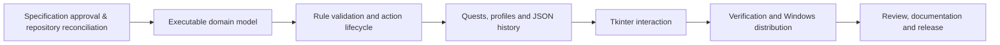

# BoardGamesWithQuests — Agent Operating Plan

This document is the **persistent working context** for implementation and maintenance agents. It records the goal, completion criteria, ordered work, current status, blockers, and verified handoffs. Agents keep it accurate throughout the project rather than creating competing plans.

**Product authority:** [PRD.md](PRD.md) describes the application completely, including gameplay, UI, domain contracts, persistence, Mermaid UML, action flow, and file structure. This file describes **how work is executed and tracked**, not what the application does.

**Canonical repository placement:** `.agents/AGENTS.md`. The root `CONTRIBUTING.md` points to it through a symlink. The product document resides at `.agents/PRD.md`, with a root `README.md` symlink. These are intended repository paths; file placement and symlink changes are separate implementation tasks performed only when authorized.

## 1. Goal

Deliver the BoardGamesWithQuests application defined in [PRD.md](PRD.md), together with its runnable Python source, an independently launchable Windows executable, current product diagrams, and a concise classroom demonstration. Keep the implementation understandable, traceable to the documented class model, and fully usable through its actual desktop interface.

### Criteria

Work is complete when all of the following have direct, reproducible evidence:

- [ ] **Specification ownership:** The reviewed PRD is the single source of product behavior; code, UML, action flow, and source layout describe the same implementation.
- [ ] **Desktop gameplay:** A complete local game operates through Tkinter, including ordinary and special Chess moves, legal-move previews, terminal results, and two local profiles.
- [ ] **Rule correctness:** The validator follows the PRD's one-action lifecycle, uses staged changes, rejects illegal actions without changing live state, and prevents recursive terminal evaluation.
- [ ] **Quests and profiles:** All six quests award the specified XP once per acting profile per match; combinations award together; saved XP remains available across sessions.
- [ ] **History and recovery:** Each match has an independent chronological JSON history; profile and history saves expose independent statuses; malformed files are preserved and ordinary failures support retry.
- [ ] **Interaction quality:** The real GUI presents piece selection, legal destinations, promotion, resignation, history, quests, outcomes, keyboard focus, and storage messages coherently.
- [ ] **Source verification:** Relevant automated tests and actual desktop interaction exercises pass on the final source, with repeatable commands and recorded results.
- [ ] **Windows distribution:** A standalone Windows application launches on a Windows machine without an installed Python interpreter and can play, award XP, and write local data.
- [ ] **Repository integration:** Required review checks pass; documentation and distribution are aligned with the merged implementation; approved repository changes follow protected-branch controls.
- [ ] **Presentation:** The owner can explain the class model, trace one action and one quest reward, show a failed action, and demonstrate the finished application.

## 2. TODO

Complete work in dependency order. Each checkbox becomes checked only when its output exists and the corresponding evidence is recorded in **Progress and handoff** below. Use small, reviewable commits or PR updates; do not treat a planning decision or code presence alone as proof of completion.

### 0 — Confirm specification and repository ownership

- [x] Obtain explicit maintainer approval of the product model and PRD.
- [ ] Inspect the actual branch, open PRs, issues, file ownership, CI requirements, and working tree before editing.
- [ ] Reconcile the canonical implementation issue, existing repository planning records, and active PR description with the approved PRD. Preserve unrelated or v2 work.
- [x] Establish `.agents/PRD.md` and `.agents/AGENTS.md` as maintained source documents; make root `README.md` and `CONTRIBUTING.md` symlinks to them. Update any generator or workflow that would overwrite those paths.
- [x] Record the reviewed base commit, target integration branch, implementation boundaries, and applicable tests in the handoff table.

### 1 — Establish the executable domain model

- [x] Map the teacher-reference class names to the PRD's source structure and implement cohesive typed Python objects.
- [x] Implement piece classes, board copying/queries, players, immutable move/action values, and `GameManager` state ownership.
- [x] Connect the installed/source application entrypoint to the Python model, with one authoritative match state.
- [x] Add core state and starting-position tests; document exact commands and results.

### 2 — Implement validation and rule execution

- [x] Implement `Rule`, `RuleContext`, ordered rule registry, and the validator's phase-specific evaluation interface.
- [x] Implement piece-movement candidates, occupancy, turn guards, king-capture prevention, raw attack detection, staged effects, and self-check rejection.
- [x] Implement castling, en passant, promotion, check, checkmate, stalemate, and resignation following the PRD contracts.
- [x] Verify legal-move previews and legal-reply searches are pure and terminal evaluation terminates predictably.
- [x] Record focused game-position regressions and their outcomes.

### 3 — Integrate quests and durable local records

- [x] Connect six rule-derived quests to accepted action matches and per-match completion tracking.
- [x] Implement profiles, XP awarding, match history, unique match identifiers, and post-commit save coordination.
- [x] Implement independent atomic JSON replacements, damaged-file preservation, visible save warnings, and retry behavior.
- [x] Verify XP attribution, simultaneous rewards, duplicate prevention, persisted profiles, and disrupted writes.

### 4 — Complete the real Tkinter experience

- [x] Implement the game setup view, 8×8 button board, player panels, history, status, and game controls.
- [x] Connect controller selection, highlights, pending promotion, resignation, match reset, and save feedback to committed domain state.
- [ ] Exercise the complete user journey through actual GUI interactions and record any remaining UI defects.

### 5 — Package and integrate

- [x] Run focused and repository-level test commands; resolve integration issues against the approved PRD.
- [x] Produce the standalone Windows build using the repository's supported release tooling and ensure assets and writable data paths work when frozen.
- [ ] Verify the executable on Windows without Python installed; record build inputs, artifact identity, and smoke-test result.
- [ ] Refresh the Mermaid diagrams in the PRD against source classes and actual dependencies.
- [ ] Prepare the user demonstration, reconcile review feedback, complete the required protected-branch integration, and record release evidence.

### Work dependency map

## 3. Agent operating protocol

### On every session

1. Read this file and [PRD.md](PRD.md), especially the relevant gameplay, source map, and rule lifecycle sections.
2. Inspect the **current repository state**: branch and commit, local changes, open work, CI, and active review comments. Never assume a historic SHA, branch name, or report is still current.
3. Pick the first unblocked task from **TODO**. If a task requires owner authorization, preserve its blocked status until approval is explicit.
4. Inspect actual interfaces and callers before modifying code. Reuse working behavior when compatible with the PRD and avoid parallel competing implementations.
5. Make the smallest coherent implementation change, with a test or other repeatable verification appropriate to its behavior.
6. Run applicable tests and review the relevant native/UI path. Record **commands, environment, commit SHA, outcome, and evidence** instead of a bare statement that something passed.
7. Update this document in the same change when a task is completed, reprioritized, blocked, or handed over. Report the remaining first unblocked task.

### Authority and scope

- The PRD decides product behavior; this file decides execution order, handoffs, and required proof. If implementation uncovers a genuine product ambiguity, record it as a **decision needed**, give a concrete proposal, and obtain maintainer approval before changing the product contract.
- Work on source, tests, documentation, packaging, and CI only within the authorized branch and task scope. Repository writes, merges, releases, issue changes, and branch cleanup require the permissions and review gates actually in force.
- Preserve the teacher-reference UML for explanation and preserve independent v2 work. The actual implemented model and its diagrams remain internally consistent.
- Do not trade a failing gameplay behavior for superficial formatting, a green import test, or a history-only merge. Tests exercise production entrypoints and user-visible behavior.
- Preserve intentionally small, explainable abstractions; avoid introducing new infrastructure where the owning class provides a clear implementation.
- Never record an unexecuted test as passing or an unreviewed branch as ready to merge.

## 4. Documentation and repository conventions

| Item | Source of truth | Root entry point |
| --- | --- | --- |
| Application description, behavior, classes, diagrams, file map, data shapes | `.agents/PRD.md` | `README.md` → `.agents/PRD.md` |
| Agent context, goal, criteria, task status, operating rules, handoffs | `.agents/AGENTS.md` | `CONTRIBUTING.md` → `.agents/AGENTS.md` |

The root entries are symlinks to canonical documents, not duplicate editable copies. Any repository documentation generator, linter, packaging step, or publishing workflow respects these ownership boundaries. Other project-specific agent instructions apply only where they are consistent with the approved PRD and authorized task.

The PRD contains the **class UML**, **action/quest flow**, and **19-module dependency map** as embedded Mermaid diagrams. Update those diagrams when the implementation changes under an approved requirement; this plan links to them rather than repeating product definitions or diagrams.

The separately generated implementation diagrams live under `docs/architecture/diagrams/`, and the authored historical class diagrams and GUI artwork are preserved under `docs/reference/`. Both locations are ordinary documentation, not alternate runtime packages. `src/` is the sole Python production tree; the old `packages/` implementation and generated `.agents/` governance records are retired. `python .github/scripts/validate_repository.py --check` checks layout without ever rewriting the canonical PRD or this file.

Code and tests use the repository's established Python tooling and test locations. Keep production modules focused on the [PRD source layout](PRD.md#7-source-layout) and keep app behavior independent of generated documentation or developer-only artifacts. Repository-specific conventions are verified from the working checkout, not inferred from this text.

## 5. Progress and handoff

**Current gate:** Cleanroom source is implemented on `v1-cleanroom` with draft PR #510 targeting `develop` (not `main`). The post-rebase `packages/` duplicate engine and obsolete governance records have been removed. Docs assets are consolidated in `docs/`. Python/Tkinter/Windows build and documentation CI passed on implementation commit `592cf512b3dc678f602cccbe1dfc507c8b4ad17c`; independent acceptance, clean-machine Windows testing and maintainer review remain **open**.

| Field | Evidence / state |
| --- | --- |
| Owner authorization | 2026-11-08 cleanroom implementation dispatch |
| Branch / PR | `v1-cleanroom` → `develop`, draft PR #510, owning issue #511 |
| Production owner | `src/` only, with 19 specified source modules, 12 rule classes, six quests and real Tkinter UI |
| Canonical documentation | `.agents/PRD.md` and `.agents/AGENTS.md`; root symlinks preserved |
| Derived docs | `docs/architecture/diagrams/` from `src/`; original diagrams and GUI SVG under `docs/reference/` |
| Source quality | Auto-format (Black 100-column config) PASS at `592cf512`, Actions #42473894740 |
| Python and native | Python 3.10–3.13, Windows x64 PyInstaller build and frozen GUI/persistence self-test PASS at `592cf512`, Actions #42473894640 |
| Documentation preview | Full docs preview/browser acceptance PASS at `592cf512`, Actions #42473898411 |
| Governance docs | Layout, generated diagrams and source consistency PASS at `592cf512`, Actions #42473898447 |
| Windows artifact | Verified 68cf9c1c candidate artifact #13614398040; fresh source artifact available from latest successful Windows workflow |
| Release status | No v1.0.0 final release; old multi-platform pipeline removed because it targeted deleted runtime. CI produces a Windows testing artifact only. |
| Remaining gates | Independent Chess/GUI review, external native pointer interactions, clean Windows host, release trust/signing and maintainer integration approval |

### 2026-11-08 — Implementation and repository consolidation

The original cleanroom application was implemented and verified in Python 3.10–3.13 and real Linux Tkinter/Xvfb. The superseded root-level `model/`, `controller/`, and `view/` skeleton packages were deleted. The later rebase onto `develop` imported `packages/` with another Chess/Draughts implementation; **all of `packages/` was deleted** to retain exactly one runtime under `src/`.

Removed `.agents/decisions/`, `.agents/notes/`, `.agents/rules/` and `.agents/{ARCHITECTURE,GOAL,PLAN,README,TODO,SCRATCHPAD}.md`. Kept `.agents/PRD.md` and `.agents/AGENTS.md` as authored authorities. Moved architecture and reference assets to `docs/` with the original reference file blobs preserved; repaired README symlink and adjusted documentation generators, tests and browser routes. Replaced the obsolete governance generator with `.github/scripts/validate_repository.py`. The diagram generator now runs with standard-library AST and never downloads a tree-sitter parser at runtime.

Retired legacy four-platform desktop packaging, obsolete version-release checks, and the associated scripts/tests referring to nonexistent `src/chesswithquests` or `src/games`; retained source verification, native Windows PyInstaller smoke, source-driven Pages preview, trusted Actions publication, DarkFactory quality and issue binding. Linked PR #510 to issue #511; kept existing `develop` → `main` promotion policy unchanged.

**Verified integration source:** `592cf512b3dc678f602cccbe1dfc507c8b4ad17c`: Python 3.10–3.13 and Windows frozen-process CI PASS (#42473894640), docs preview PASS (#42473898411), governance docs PASS (#42473898447), autoformat PASS (#42473894740). Full DarkFactory quality on this exact revision was still running when this record was written. Independent release acceptance is not complete.

## 6. Maintenance rules for this document

- Treat **Goal** and **Criteria** as stable until an approved product change. The PRD is the only place that defines application behavior.
- Keep **TODO** in dependency order; split or reorder tasks when real implementation evidence requires it. Do not silently delete incomplete work.
- Mark a task complete only after its changes and proof are available. Reopen a previously completed task when a regression invalidates that proof.
- Update **Progress and handoff** after every meaningful working session, including blockers, exact refs, executed verification, and the next owner/action.
- Keep the file concise. Link to PRs, issues, logs, and tests rather than pasting long investigation transcripts or duplicating PRD material.
- When an agent changes this document, include the update with its implementation commit or PR so the context and work remain synchronized.
