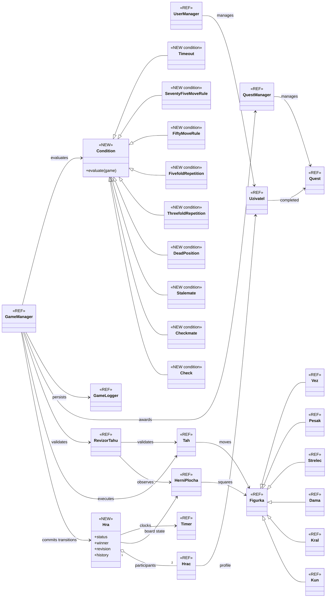
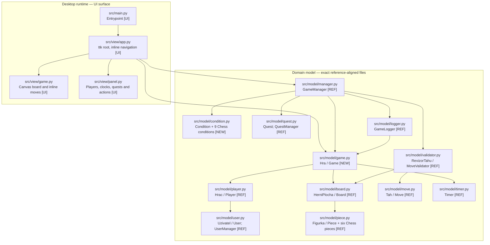

# BoardGamesWithQuests v1.0.0 — Chess Desktop Completion and Release

**Canonical work item:** [#430](https://github.com/marius-patrik/BoardGamesWithQuests/issues/430) · **Implementation:** [PR #495](https://github.com/marius-patrik/BoardGamesWithQuests/pull/495) (`v1 → develop`) · **Release promotion:** [PR #501](https://github.com/marius-patrik/BoardGamesWithQuests/pull/501) (`develop → main`) · **Future v2:** [PR #496](https://github.com/marius-patrik/BoardGamesWithQuests/pull/496), issue #348 · **Release:** `v1.0.0`.

**Product contract:** One local, Python-defined **Chess** desktop application. The game includes orthodox FIDE moves, clocks, quests, player information, game history, crash-durable per-game JSON logs, and resume. Its Tkinter Canvas board and surrounding modern monochrome ttk interface provide all interaction inline. The maintainer tests published binaries after release; implementation supplies focused gameplay regressions and verified four-platform packaging.

**Naming contract:** For every Czech-named class specified by the maintainer's PR #495 reference UML, its Czech name is the actual Python class and its English equivalent is a simple alias of the *same* class (for example, `class HerniPlocha`, `Board = HerniPlocha`). Classes already named in English in the UML keep that English name. Newly approved classes use English except `Hra`, which has `Game = Hra`. All module filenames are English. Persistence field names are versioned independently of Python aliases.

**Class boundary:** Implement exactly the referenced domain classes that serve v1 Chess, plus approved `Hra`, `Condition`, and the Chess condition subclasses below. `Hra` contains state, participants, clocks, history, status and result; `GameManager` is the single authority that validates/commits transitions. `winner` is an optional `Hrac`: it is absent for stalemate and other drawn games. No standalone result class is necessary.

## Phase 1 — Implement the target architecture and finish PR #495

### 1. Exact target production-file map

The following **16 Python source files are the target application-source allowlist**. Each exists to host a referenced class, an explicitly requested extension or the indispensable Tkinter entry/view surface. Merge, move and remove superseded production modules after migrating their call sites. Test files, repository build metadata, GitHub workflows, documents, resources and generated diagrams are support artifacts and do not add application classes.

| # | Target file | Classes / responsibilities | Source |
| ---: | --- | --- | --- |
| 1 | `src/main.py` | Desktop entrypoint and launch | UI runtime |
| 2 | `src/model/user.py` | `Uzivatel` / `User`, `UserManager` | REF |
| 3 | `src/model/player.py` | `Hrac` / `Player` | REF |
| 4 | `src/model/board.py` | `HerniPlocha` / `Board`; cells, initial Chess placement and piece updates | REF |
| 5 | `src/model/piece.py` | `Figurka` / `Piece`; `Kun`/`Knight`, `Kral`/`King`, `Dama`/`Queen`, `Strelec`/`Bishop`, `Pesak`/`Pawn`, `Vez`/`Rook` | REF |
| 6 | `src/model/move.py` | `Tah` / `Move` | REF |
| 7 | `src/model/validator.py` | `RevizorTahu` / `MoveValidator`; movement, king safety, castling, en passant, promotion, mating reachability proofs | REF |
| 8 | `src/model/manager.py` | `GameManager`; atomic actions, rule priority, terminal decisions, quest/clock coordination | REF |
| 9 | `src/model/game.py` | `Hra` / `Game`; unified game state and session lifecycle, status, winner/draw, actions, replay, revision | NEW |
| 10 | `src/model/condition.py` | `Condition`, `Check`, `Checkmate`, `Stalemate`, `DeadPosition`, `ThreefoldRepetition`, `FivefoldRepetition`, `FiftyMoveRule`, `SeventyFiveMoveRule`, `Timeout` | NEW conditions |
| 11 | `src/model/timer.py` | `Timer` | REF |
| 12 | `src/model/quest.py` | `Quest`, `QuestManager` | REF |
| 13 | `src/model/logger.py` | `GameLogger`; one secure atomic JSON save/activity log per game | REF |
| 14 | `src/view/app.py` | ttk root, monochrome theme, inline app navigation, state feedback and lifecycle | UI runtime |
| 15 | `src/view/game.py` | Existing Canvas board and inline promotion, moves and legal destinations | UI runtime |
| 16 | `src/view/panel.py` | Two player panels, clocks, quests, history, inline game commands and confirmations | UI runtime |

**Source layout:** `src/main.py`; `src/model/` containing exactly the twelve model files above; `src/view/` containing exactly `app.py`, `game.py`, `panel.py`. Keep real Python package/import requirements satisfied using the existing supported namespace-package approach. All application controller behavior is owned by `view/app.py` (UI routing) and `GameManager` (game transitions).

**Auxiliary repository paths:** root `tests/`, root `scripts/`, `.github/workflows/`, `.agents/`, `pyproject.toml` and `repo.dfconfig` retain their required testing, tooling, documentation and packaging roles. Writable activity records resolve under the user's application data root as `data/logs/<game-id>.json`, not into packaged source/assets.

### 2. Approved class and condition rules

**REF / Czech primary + English alias:** `Uzivatel/User`, `Hrac/Player`, `HerniPlocha/Board`, `Figurka/Piece`, `Tah/Move`, `RevizorTahu/MoveValidator`, `Kun/Knight`, `Kral/King`, `Dama/Queen`, `Strelec/Bishop`, `Pesak/Pawn`, `Vez/Rook`.

**REF / English primary:** `GameManager`, `Timer`, `Quest`, `QuestManager`, `GameLogger`, `UserManager`.

**NEW / explicitly requested:** `Hra` with `Game = Hra`; `Condition` with the following **nine Chess-only subclasses**, all in the single `condition.py` file:

| Condition | Purpose | Decision semantics |
| --- | --- | --- |
| `Check` | King under attack | Position status |
| `Checkmate` | Checked player has no legal move | Automatic win |
| `Stalemate` | Player has no legal move and is not in check | Automatic draw |
| `DeadPosition` | Neither side can ever legally give checkmate | Automatic draw, sound proof |
| `ThreefoldRepetition` | Claimable repeated position | Draw on valid claim |
| `FivefoldRepetition` | Automatic repeated position | Automatic draw |
| `FiftyMoveRule` | Claimable 50-move threshold | Draw on valid claim |
| `SeventyFiveMoveRule` | Automatic 75-move threshold | Automatic draw, subject to checkmate precedence |
| `Timeout` | Active player's clock expires | Winner, draw or pending according to sound opposing-side mating reachability |

Draw agreement and resignation are game actions resolved by `GameManager`; promotion, castling and en passant are move-validation behavior owned by `RevizorTahu`. The `Condition` API supports an explicit undecidable result where sound proof is unavailable. `Hra` records `status`, optional `winner`, result reason and a replayable pending timeout when needed. The implementation must pass the four independent existing Chess dead/live/mate-priority regressions and focused persistence/replay tests.

### 3. Reference UML — target class diagram

**Legend:** `REF` = class required by the posted PR #495 reference UML. `NEW` = explicitly requested addition. `NEW condition` = Chess condition extension. Class labels are *primary Python class names*; English aliases are defined above. UML export-writer classes are outside the selected Chess product contract.

### 4. Exact file-to-class architecture map

The following Mermaid chart contains **the complete target production-source file set**; its labels show their assigned classes and which source items are from the reference or newly approved. No additional production Python module is planned.

### 5. Ordered implementation roadmap

**1 — Contract and source ownership.** Define `Hra`, `GameManager`, `Condition`, aliases and the exact 16-file target map. Move `session.py → game.py`. Update entrypoint, imports and interfaces while preserving existing gameplay and saved-session semantics.

**2 — Python Chess model.** Replace runtime JSON game configuration with direct Python Chess classes and rule logic in `board.py`, `piece.py`, `move.py`, `validator.py`, `condition.py` and `manager.py`. Implement initial setup, full legal moves, promotions, turn handling, quest evaluation and terminal/draw rules. Transition installed/frozen application startup to the Python model. Keep the four sourced FIDE regressions active through the change.

**3 — Fold the model into its owners.** Move `schema.py`, `outcomes.py`, `conditions.py`, `hooks.py`, `capture_policy.py`, `capture_geometry.py`, `board_queries.py`, `snapshot_queries.py` and superseded `definition.py` responsibilities into `validator.py`, `condition.py`, `board.py`, `game.py` and `manager.py`. Put quests and quest management in `quest.py`, clock behavior in `timer.py`, player/user behavior in `player.py` and `user.py`. Convert all consumers before deleting redundant modules.

**4 — Finish FIDE and session durability.** Implement automatic and claimable conditions with explicit precedence; maintain sound possible/impossible/unknown mating analysis. Persist unresolved flag falls, suspend clocks, support resume/replay and use inline participant-visible resolution controls. Ensure mate takes priority at the 75-move boundary and stalemate is an explicit draw. Verify Chess regression behavior using existing focused tests.

**5 — Game logging.** Consolidate `persistence.py` into `logger.py`. Write one atomic, revisioned JSON file per game at the writable application data root's `data/logs/<game-id>.json`, with safe paths, event history, crash recovery, per-game resume and historical-save migration. Keep gameplay storage under `GameLogger` and state under `Hra`.

**6 — Dialog-free desktop UI.** Fold the gameplay controller into `app.py` and `GameManager`; migrate Canvas `board.py → view/game.py`; merge player quests into `panel.py`; move inline navigation/status/controls into `app.py`. Render move/promotion choices, draw offers/claims, resignation confirmation, new-game selection, error reporting and pending-adjudication resolution **inside the existing app/panel/board layout**. Use ttk frames, labels, buttons and inline expansion; retain responsive focus, mouse interaction, closing and restart behavior. Build the fixed monochrome theme in `app.py`. Remove dedicated modal, dialog-lifecycle, screen, settings and controller modules after their functions have been integrated.

**7 — Converge repository tooling and packaging.** Move repository-owned tests and scripts to root `tests/` and `scripts/`; update all Actions selectors/build scripts and source-generated documentation. Rebuild wheel/sdist and Windows x64, macOS ARM64/x64 and Linux x64 assets with Python Chess rules, correct resource manifests, version metadata and SHA256 checks. Maintain manually selectable native GUI QA. Route documentation deployment faults to issue #430 and verify documentation workflow execution.

**8 — Review integration.** Address PR #495's 22 inline threads and overall Python/UML review with code-level evidence, including changes to the JSON rule placement, game/session naming, model decomposition, logging, visual interface, player settings and removal of modal dialogs. Obtain the maintainer's review disposition and required CI before promotion.

**Phase 1 completion:** PR #495 contains the 16-file target product, complete Python Chess, canonical model classes and aliases, required condition classes, inline dialog-free UI, one atomic log per game and four-platform release-ready packages.

## Phase 2 — Publish v1.0.0 and finalize the repository

1. Obtain approval for [PR #495](https://github.com/marius-patrik/BoardGamesWithQuests/pull/495) and merge `v1 → develop` under protected GitHub controls. Verify the merge SHA and live default-branch documentation deployment.
2. Update and obtain approval for existing [PR #501](https://github.com/marius-patrik/BoardGamesWithQuests/pull/501) and merge `develop → main` under protected GitHub controls.
3. Enable the existing `repo.dfconfig` Python release publication setting on the reviewed release source. Use PrideVer and the existing GitHub Actions workflow to publish `v1.0.0` from `main`.
4. Publish and checksum Windows x64, macOS ARM64, macOS x64 and Linux x64 distributions; verify published artifacts, source provenance and signing/notarization disclosures. Provide installation instructions for maintainer-led gameplay/GUI/native testing.
5. Merge released `main` ancestry into `v2` while preserving [PR #496](https://github.com/marius-patrik/BoardGamesWithQuests/pull/496) and its unique work. Delete the integrated `v1` branch, preserve release/archive tags and close #430 after publication.
6. Verify exactly three branches—`main`, `develop`, `v2`—and exactly one open issue, #348.

**Release report:** implementation and release SHAs, PR review dispositions, focused regression results, source-file map, documentation deployment, four binary/checksum links, trust guidance and final repository inventory.
