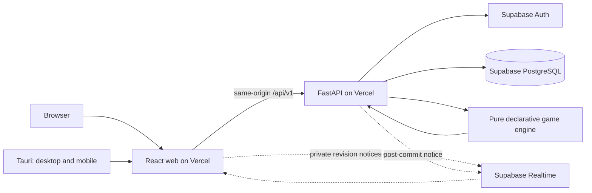

# BoardGamesWithQuests — Product & Architecture Specification

## 1. Product

BoardGamesWithQuests is a two-player online board-game application with configurable, declaratively defined rules and quests. A single hosted React application is used in browsers and inside a Tauri native wrapper. A stateless Python service authoritatively evaluates gameplay; Supabase persists identity, game state, events, account data, and progression.

### 1.1 Product capabilities

- Exactly two distinct authenticated users participate in a game. No separate room abstraction, matchmaking, spectators, bots, tournaments, social feed, or leaderboard.
- A player may use a Supabase anonymous guest account or a registered account; converting a guest to a registered user preserves the same identity and history.
- Three built-in games are selectable: orthodox chess (default), English draughts (8×8), and international draughts (10×10). Each is a full JSON definition interpreted by the same engine.
- A user can create, duplicate, edit, rename, and delete personally owned variants using visual forms for board, pieces, rules, quests, and clocks. Built-ins are immutable. No user-supplied Python, JavaScript, plugins, paths, or executable expressions.
- The creator selects a definition and time control, creates a pending game, and shares its opaque URL. A different user joins the existing game; joining starts play.
- Players see board, side, coordinates, legal-move hints, captured pieces, move history, both clocks, status, quests, results, and account progression. A full capture chain is one move.
- Accepted moves, outcomes, clocks, quest progress, awards, ratings, definitions, and history survive page reloads, client replacement, and function restarts.
- Both clients receive private realtime revision notifications and reload authoritative state when needed. HTTP alone remains sufficient to play.
- Players can resign, offer/accept a draw, claim a rules-supported draw, and flag a timed-out opponent. Complete games are read-only and exportable.
- Chess supports SAN/PGN, FEN position import/export, coordinate/letter transcripts, and compressed transcript output. Draughts supports PDN where the shipped definition provides notation.
- One responsive, accessible UI supports mouse, touch, keyboard, screen readers, and mobile displays.

The user-controlled definition governs the game. UI components and generic engine code never branch on a game title to decide what is legal.

### 1.2 Game lifecycle

`pending`: a creator exists, a complete validated definition is pinned, no other participant or active clock exists. The creator receives a share URL. A pending game expires after 24 hours if nobody joins.

`active`: a verified, distinct joiner has atomically claimed the second seat. Creator is side `1`, joiner side `-1`; the selected definition determines which side moves first. An activation event records the initial state at revision `0`.

`finished`: an authoritative rules result, resignation, accepted draw, or timeout has ended play. No new actions are accepted apart from exact idempotent retries.

`expired`: a pending invitation has expired without ever becoming an active game. It has no result or rating impact.

Each accepted domain action increases the revision by exactly one; a complete capture sequence, promotion, or castling transition remains one action. Pending expiration and joining are mutually exclusive under a database row lock.

## 2. Runtime architecture



**Web:** Bun, React, TypeScript, Rsbuild, Tailwind, shadcn/ui, Motion. Static files are hosted on Vercel. Only the web project contains UI. The browser handles selection, drag/touch interaction, form drafts, rendering, client-side countdown animation, and API subscriptions; it cannot commit state or resolve outcomes.

**Native:** Bun tooling + Tauri 2/Rust host, packaging the hosted web origin as a constrained WebView. The same production UI and HTTP API are used on Windows, macOS, Linux, Android, and iOS. There is no local engine, embedded server, duplicated frontend, or independent game store.

**API:** Python + FastAPI/Pydantic in a separate Vercel project. It verifies the Supabase identity, enforces participant access, validates and authorizes requests, starts database transactions, invokes the pure engine, commits accepted transitions, and serves read projections and exports. Instances are stateless.

**Engine:** Python package contained inside the server package. It has no I/O, network access, database client, authentication provider, web framework, user scripts, or persistent process state. Every transition is deterministic given the pinned definition, snapshot, actor, action, and trusted timestamp.

**Database:** Supabase Auth maintains `auth.users`. Private PostgreSQL schema `bgwq` owns all application records. A server-only PostgreSQL connection through the supported transaction pooler performs multi-record atomic writes. No browser direct access to game tables.

**Realtime:** Supabase private Broadcast distributes scoped revision hints, not state or commands. Clients recover lost, duplicated, delayed, or reordered notifications by reading the API. Realtime transport never participates in transaction correctness.

**Origin:** The web Vercel project rewrites `/api/*` to the API Vercel project, retaining the public web origin. Mutations require cookies, a valid Origin, and CSRF protection; direct access to the API origin must not bypass identity or Origin rules. Both deployments use compatible contract versions.

## 3. Source tree and package boundaries

```text
.
├── .agents/
│   └── PRD.md
├── README.md                       -> .agents/PRD.md (Git symlink)
├── package.json                    # Bun workspace; web + native
├── bun.lock                        # one locked JS dependency graph
├── packages/
│   ├── server/
│   │   ├── pyproject.toml          # Python version, dependencies, package metadata
│   │   ├── requirements.txt        # Vercel Python deployment dependencies
│   │   ├── vercel.json
│   │   ├── api/
│   │   │   ├── __init__.py
│   │   │   ├── index.py            # Vercel-discovered ASGI app export
│   │   │   ├── app.py              # FastAPI application + middleware
│   │   │   ├── routes/
│   │   │   │   ├── auth.py
│   │   │   │   ├── accounts.py
│   │   │   │   ├── definitions.py
│   │   │   │   ├── variants.py
│   │   │   │   └── games.py
│   │   │   ├── contracts/          # Pydantic request/response DTOs
│   │   │   ├── security/           # Auth, CSRF, permission policy
│   │   │   ├── persistence/        # SQL transactions, queries, mapping
│   │   │   └── notifications/      # Realtime sender and token authorization
│   │   ├── engine/
│   │   │   ├── definition.py       # Parser, type checker, normalized definitions
│   │   │   ├── schema.py           # Versioned declarative JSON grammar
│   │   │   ├── geometry.py         # Squares, vectors, rays, attacks
│   │   │   ├── candidates.py       # Candidate/capture-path enumeration
│   │   │   ├── interpreter.py      # Typed conditions, queries, effects, hooks
│   │   │   ├── transition.py       # Pure init/legal/status/apply/replay
│   │   │   ├── clocks.py           # Trusted timestamp arithmetic
│   │   │   ├── quests.py           # Progress and award intents
│   │   │   ├── notation.py         # Format-independent export dispatch
│   │   │   └── contracts.py        # Immutable engine DTOs
│   │   ├── definitions/
│   │   │   ├── chess.json
│   │   │   ├── english_draughts.json
│   │   │   └── international_draughts.json
│   │   ├── formats/
│   │   │   ├── chess.py            # PGN, SAN, FEN and transcript codecs
│   │   │   └── draughts.py         # PDN and transcript codecs
│   │   └── supabase/
│   │       ├── config.toml
│   │       └── migrations/
│   │           └── <timestamp>_initial_schema.sql
│   ├── web/
│   │   ├── package.json
│   │   ├── vercel.json
│   │   ├── rsbuild.config.ts
│   │   ├── tsconfig.json
│   │   ├── components.json         # shadcn component generator
│   │   ├── index.html
│   │   └── src/
│   │       ├── main.tsx
│   │       ├── app/                # Navigation, session, query/reconnect logic
│   │       ├── api/                # Generated OpenAPI types + typed transport
│   │       ├── games/              # Board, actions, clocks, history, quests
│   │       ├── variants/           # Schema-driven config builder
│   │       ├── accounts/           # Guest/login/profile/progression
│   │       ├── components/ui/      # Shared shadcn components
│   │       ├── styles/
│   │       └── assets/
│   └── native/
│       ├── package.json
│       └── src-tauri/
│           ├── Cargo.toml
│           ├── tauri.conf.json
│           ├── capabilities/default.json
│           ├── icons/
│           └── src/main.rs
└── tests/                          # Black-box contracts and actual actor flows
    ├── engine/
    ├── api/
    ├── database/
    ├── browser/
    └── native/
```

**Dependency direction:**
- `server/engine` may import only its own pure types and approved deterministic libraries. It neither imports `server/api` nor knows Supabase.
- `server/api` imports `engine`, `definitions`, `formats`, and its private provider/persistence adapters. It is the sole authority for identity, authorization, state mutation, and public serialization.
- `definitions` are data. Built-in game behavior never requires a game-specific Python class. Formatters may implement presentation conventions but may not change domain rules.
- `server/supabase` defines the persistence schema. SQL and the Python persistence adapter must agree on keys, constraints, privileges, and transaction boundaries.
- `web` consumes only versioned HTTP/realtime contracts; generated transport types derive from FastAPI OpenAPI. It does not import Python code, implement game legality, or depend on private SQL layout.
- `native` depends on the hosted web origin and Tauri APIs only. It does not fork React and grants the remote origin no unnecessary native capabilities.
- Shared business state is never written to localStorage, IndexedDB, device files, or process-global variables.

## 4. Declarative definition schema

All games, including shipped games and editable variants, use one validated JSON document. Its `schema_version` is `1`. Values are immutable within an active game: creation copies and hashes the fully resolved definition. The interpreter supports no executable author code.

### 4.1 Top-level structure

```ts
type Side = 1 | -1;
type Square = [row: number, column: number]; // zero-based integer coordinates
type Definition = {
  schema_version: 1;
  key: string;                 // e.g. "chess", stable builtin key
  name: string;
  board: {
    rows: number;              // integer 2..32
    columns: number;           // integer 2..32
    playable_squares?: Square[]; // omitted = entire rectangle
    initial: Array<{ at: Square; piece: string; side: Side }>;
  };
  pieces: Array<{
    id: string;
    name: string;
    glyphs: { "1": string; "-1": string };
    notation?: string;
    moves: Movement[];
    attacks?: Movement[];      // omitted = the capture geometry
    capture: "none" | "optional" | "mandatory";
    promotion?: {
      at: "far_rank" | { rows: number[] };
      into: string[];
      timing: "on_reach" | "after_turn";
    };
  }>;
  starting_side: Side;
  clock: { initial_ms: number; increment_ms: number };
  initial_rule_state: Record<string, JsonValue>;
  rules: Rule[];
  quests: Quest[];
  notation: Array<"pgn" | "fen" | "letter" | "coordinate" | "stenographic" | "pdn">;
  appearance: {
    light_square: string;
    dark_square: string;
    board_label?: string;
  };
};
type Movement = {
  delta: Square;               // side-relative row vector
  range: number | "ray";
  mode: "quiet" | "capture" | "both";
  jump?: boolean;
  only_unmoved?: boolean;
};
type Rule = {
  id: string;
  enabled: boolean;
  priority: number;
  hook: "available_moves" | "permits_move" | "on_move_made" | "outcome" | "status";
  when: Condition;
  effects: Effect[];
};
type Quest = {
  id: string;
  name: string;
  description: string;
  when: "after_move" | "at_game_end";
  target: number;              // positive integer
  reward: number;              // nonnegative integer
  progress: Query;             // per-actor pure integer query
  complete_when: Condition;
};
type JsonValue = null | boolean | number | string | JsonValue[] | { [k: string]: JsonValue };
type Value = JsonValue | { ref: string } | Query;
type Query = { query: string; args: Record<string, Value> };
type Condition =
  | { op: "true" | "false" }
  | { op: "all" | "any"; items: Condition[] }
  | { op: "not"; item: Condition }
  | { op: "compare"; comparator: "eq" | "ne" | "lt" | "lte" | "gt" | "gte" | "in"; left: Value; right: Value };
type Effect = { effect: string; args: Record<string, Value> };
```

Only documented field names and enumerations are accepted, with validation of exact type (including bool distinct from integer). Every identifier in a definition has unique, deterministic meaning. All board coordinates and movement ranges must be within structural limits. A valid definition must initialize a coherent game and allow its configured start rules to be evaluated. The editor is generated from these same schema descriptions, not separately hardcoded game forms.

### 4.2 Interpreter primitives

**References:** `actor.id`, `actor.side`, `turn.side`, `move.start`, `move.hops`, `move.promotion`, `position.before`, `position.after`, `board.rows`, `board.columns`, `clock.remaining`, `rule.state.*`, `quest.progress.*`, `history.revision`, `result`. Unknown references are errors.

**Queries:** `piece_at`, `pieces_matching`, `path_clear`, `squares_attacked`, `capture_paths`, `capture_count`, `legal_action_count`, `repetition_count`, `halfmove_count`, `clock_remaining`, `rule_state`, `special_rights`, `temporary_target`, `position_identity`, `quest_progress`, `last_event`. Each has an explicit typed argument/result definition in `engine/schema.py`. Queries read only the explicitly selected observed or simulated position.

**Effects:** `permit`, `deny`, `offer_move`, `move_piece`, `capture_piece`, `replace_piece`, `set_rule_state`, `increment_rule_state`, `set_rights`, `set_temporary_target`, `propose_result`, `emit_event_metadata`, `complete_quest`. Every effect has a type-checked payload, deterministic ordering, and a hook-specific permission set. Effects operate on a proposed isolated transition, never on the authoritative input object.

**Hook sequence:** geometrical candidates → `available_moves` offers → complete hypothetical board transition → `permits_move` → `on_move_made` → quest evaluation → `outcome` arbitration → read-only `status`. A move requires affirmative permission and no denial. Configured priority resolves outcomes; an unresolvable conflict rejects the action. Hooks cannot directly alter account data, service clocks, participant identity, or database records.

Required generic geometry includes directional and side-relative vectors, rays, leapers, first-move conditions, forced and maximal capture-path selection, short/flying kings, deferred capture removal, en passant-style temporary targets, promotion, auxiliary relocation (castling), king-safety attacks, and configurable repetition identities. These are interpreter capabilities, never chess-name switches.

### 4.3 Safety and determinism

- Definition ≤ 256 KiB, JSON depth ≤ 32, AST depth ≤ 12, ≤ 256 AST nodes per rule/quest, ≤ 128 rules and 128 quests, board ≤ 32×32, capture path ≤ 128 hops, generated candidates ≤ 4,096, snapshot ≤ 4 MiB.
- One evaluation has a deterministic budget of 250,000 primitive work units. A hit causes a typed rejection; never accept a truncated move list or partial transition.
- No reflection, dynamic imports, user-defined callable hooks, code evaluation, filesystem/network queries, or hidden mutable singleton state.
- Serialization uses RFC 8785 canonical JSON and SHA-256 for definition, snapshot, and request digests. Engine results for identical inputs are identical.

## 5. Engine state and contract

### 5.1 Engine interface

```python
validate_definition(document: bytes) -> Definition
initialize(definition: Definition, game_id: UUID,
           creator: UUID, joiner: UUID, at_ms: int) -> Snapshot
legal_actions(definition: Definition, snapshot: Snapshot,
              actor: UUID, at_ms: int) -> list[LegalAction]
status(definition: Definition, snapshot: Snapshot,
       actor: UUID, at_ms: int) -> Status
apply(definition: Definition, snapshot: Snapshot, actor: UUID,
      action: Action, at_ms: int) -> Transition
reconstruct(definition: Definition, activation: Event,
            events: list[Event]) -> Snapshot
```

The engine trusts neither client claims nor prior in-process state. `apply` is pure and returns a new immutable snapshot, one domain event, proposed award intents, and an optional terminal settlement intent. The API determines authorization, revision, idempotency and server time before calling it.

### 5.2 Canonical persisted snapshot

```ts
type Snapshot = {
  schema_version: 1;
  revision: number;                // activation = 0
  game_id: string;
  definition_digest: string;       // lowercase SHA-256 hex in API JSON
  players: { "1": string; "-1": string }; // immutable Supabase Auth UUIDs
  board: Array<{ at: Square; piece: string; side: Side; moved: boolean }>;
  active_side: Side;
  captured: Array<{ piece: string; side: Side; at_revision: number }>;
  rule_state: Record<string, JsonValue>;
  special_rights: Record<string, JsonValue>;
  temporary_targets: Record<string, JsonValue>;
  position_counts: Record<string, number>; // repetition identity -> appearances
  halfmove_count: number;
  quests: Record<string, Record<string, { current: number; target: number; completed: boolean }>>;
  clocks: {
    "1": { remaining_ms: number; increment_ms: number };
    "-1": { remaining_ms: number; increment_ms: number };
    anchor_ms: number;             // when active side last started clock
  };
  draw_offer_by: string | null;
  result: GameResult | null;
};
type GameResult = {
  kind: "win" | "draw";
  winner_id: string | null;        // null exactly when drawn
  reason: string;                 // validated rule/cause identifier
};
type Action =
  | { type: "move"; move: { start: Square; hops: Square[]; promotion: string | null } }
  | { type: "resign" }
  | { type: "offer_draw" }
  | { type: "accept_draw" }
  | { type: "claim_draw"; rule_id: string; intended_move: ActionMove | null }
  | { type: "timeout" };
type ActionMove = { start: Square; hops: Square[]; promotion: string | null };
```

All state necessary to determine legal moves, repetition, clocks, outcomes and per-player quests lives in this snapshot and the immutable pinned definition. Events hold full accepted history; snapshots do not duplicate the transcript. Stored snapshots and events must agree on revision and SHA-256 digest at every commit.

### 5.3 Rules and timers

Chess must satisfy official orthodox FIDE gameplay including check, mate, stalemate, promotion choices, castling, en passant, repetition, move counters, claimable/automatic draws and timeout-without-mating-material. English draughts must enforce forced complete captures, short kings, and crowning ending the turn. International draughts must enforce 10×10 play, backward captures by men, flying kings, maximum-capture path, deferred capture blockers, and end-of-turn promotion. Each shipped game includes quests and appropriate notation formats.

Clocks use integer milliseconds and database-trusted UTC timestamps. They are initialized only on joining; elapsed time is charged to the side whose clock is running. An accepted legal move charges its time, applies its increment once, and starts the opponent's clock. A rejected/duplicate action never charges again or grants an increment. Read projections include server time and the remaining time computed for that instant; client ticking is visual only. On any authorized game read or action after expiry, the API resolves any due flag-fall within an atomic transaction; no resident timer or paid scheduler is necessary. A draw offer does not pause either clock.

Every action is a complete legal command. Capture paths list all landing squares. A terminal transition evaluates final quests and persists any awards and both ratings in the same database transaction as the final game event.

## 6. Persistent data model: Supabase PostgreSQL

### 6.1 Ownership

Supabase Auth is the identity authority. Application SQL objects live in private schema `bgwq`. All application table mutations are performed through the authenticated FastAPI service; no table is exposed to client roles. Guest and registered accounts both reference `auth.users.id`. No duplicate password/user-auth table exists.

The application contains **exactly six authoritative tables**:

| Table | Responsibility |
| --- | --- |
| `profiles` | Public-facing profile attributes for an Auth user |
| `game_variants` | User-owned validated JSON definitions and revisions |
| `games` | Membership, pinned definition, lifecycle, canonical snapshot and result |
| `game_events` | Immutable ordered activation/domain events and idempotency records |
| `achievement_awards` | Permanent account XP credits earned in eligible games |
| `game_ratings` | Per-user rating and results for each rated built-in ruleset |

Individual in-game quest counters are in `games.snapshot.quests`. Lifetime XP is derived by summing `achievement_awards.points`; there is no separately mutable `total_xp` column. Custom variants are unranked and cannot mint permanent XP, preventing author-controlled ratings/reward farming.

### 6.2 Complete initial SQL schema

```sql
CREATE SCHEMA IF NOT EXISTS bgwq;

CREATE TABLE bgwq.profiles (
  user_id uuid PRIMARY KEY REFERENCES auth.users(id) ON DELETE RESTRICT,
  display_name text NOT NULL CHECK (char_length(btrim(display_name)) BETWEEN 1 AND 64),
  username text NULL CHECK (username ~ '^[a-z0-9_]{3,32}$'),
  created_at timestamptz NOT NULL DEFAULT now(),
  updated_at timestamptz NOT NULL DEFAULT now()
);
CREATE UNIQUE INDEX profiles_username_unique
  ON bgwq.profiles (lower(username)) WHERE username IS NOT NULL;

CREATE TABLE bgwq.game_variants (
  id uuid PRIMARY KEY,
  owner_id uuid NOT NULL REFERENCES auth.users(id) ON DELETE RESTRICT,
  name text NOT NULL CHECK (char_length(btrim(name)) BETWEEN 1 AND 80),
  base_key text NOT NULL,
  definition_version integer NOT NULL CHECK (definition_version = 1),
  definition jsonb NOT NULL CHECK (jsonb_typeof(definition) = 'object'),
  definition_digest bytea NOT NULL CHECK (octet_length(definition_digest) = 32),
  revision bigint NOT NULL DEFAULT 1 CHECK (revision >= 1),
  created_at timestamptz NOT NULL DEFAULT now(),
  updated_at timestamptz NOT NULL DEFAULT now()
);
CREATE UNIQUE INDEX variants_owner_name_unique
  ON bgwq.game_variants (owner_id, lower(name));

CREATE TABLE bgwq.games (
  id uuid PRIMARY KEY,
  creator_id uuid NOT NULL REFERENCES auth.users(id) ON DELETE RESTRICT,
  joiner_id uuid NULL REFERENCES auth.users(id) ON DELETE RESTRICT,
  created_action_id text NOT NULL CHECK (char_length(created_action_id) BETWEEN 1 AND 128),
  join_action_id text NULL CHECK (char_length(join_action_id) BETWEEN 1 AND 128),
  source_variant_id uuid NULL REFERENCES bgwq.game_variants(id) ON DELETE SET NULL,
  definition_key text NOT NULL,
  rated_ruleset_key text NULL,
  config_snapshot jsonb NOT NULL CHECK (jsonb_typeof(config_snapshot) = 'object'),
  config_digest bytea NOT NULL CHECK (octet_length(config_digest) = 32),
  status text NOT NULL CHECK (status IN ('pending', 'active', 'finished', 'expired')),
  revision bigint NOT NULL DEFAULT 0 CHECK (revision >= 0),
  snapshot jsonb NULL CHECK (snapshot IS NULL OR jsonb_typeof(snapshot) = 'object'),
  snapshot_digest bytea NULL CHECK (snapshot_digest IS NULL OR octet_length(snapshot_digest) = 32),
  result jsonb NULL CHECK (result IS NULL OR jsonb_typeof(result) = 'object'),
  created_at timestamptz NOT NULL DEFAULT now(),
  updated_at timestamptz NOT NULL DEFAULT now(),
  started_at timestamptz NULL,
  finished_at timestamptz NULL,
  pending_expires_at timestamptz NOT NULL,
  rating_settled_at timestamptz NULL,
  UNIQUE (creator_id, created_action_id),
  CHECK (joiner_id IS NULL OR joiner_id <> creator_id),
  CHECK (
    (status IN ('pending', 'expired')
      AND joiner_id IS NULL AND snapshot IS NULL
      AND snapshot_digest IS NULL AND started_at IS NULL
      AND result IS NULL AND revision = 0 AND join_action_id IS NULL)
    OR
    (status = 'active'
      AND joiner_id IS NOT NULL AND join_action_id IS NOT NULL
      AND snapshot IS NOT NULL AND snapshot_digest IS NOT NULL
      AND started_at IS NOT NULL AND result IS NULL
      AND finished_at IS NULL)
    OR
    (status = 'finished'
      AND joiner_id IS NOT NULL AND join_action_id IS NOT NULL
      AND snapshot IS NOT NULL AND snapshot_digest IS NOT NULL
      AND started_at IS NOT NULL AND finished_at IS NOT NULL
      AND result IS NOT NULL)
  ),
  CHECK (rating_settled_at IS NULL OR (status = 'finished' AND rated_ruleset_key IS NOT NULL))
);
CREATE INDEX games_creator_idx ON bgwq.games (creator_id, created_at DESC);
CREATE INDEX games_joiner_idx ON bgwq.games (joiner_id, created_at DESC)
  WHERE joiner_id IS NOT NULL;

CREATE TABLE bgwq.game_events (
  game_id uuid NOT NULL REFERENCES bgwq.games(id) ON DELETE RESTRICT,
  revision bigint NOT NULL CHECK (revision >= 0),
  actor_id uuid NOT NULL REFERENCES auth.users(id) ON DELETE RESTRICT,
  action_id text NOT NULL CHECK (char_length(action_id) BETWEEN 1 AND 128),
  expected_revision bigint NULL,
  event_type text NOT NULL CHECK (event_type IN (
    'activation', 'move', 'resign', 'offer_draw',
    'accept_draw', 'claim_draw', 'timeout'
  )),
  request_digest bytea NOT NULL CHECK (octet_length(request_digest) = 32),
  payload jsonb NOT NULL CHECK (jsonb_typeof(payload) = 'object'),
  previous_digest bytea NULL CHECK (previous_digest IS NULL OR octet_length(previous_digest) = 32),
  state_digest bytea NOT NULL CHECK (octet_length(state_digest) = 32),
  committed_at timestamptz NOT NULL DEFAULT now(),
  PRIMARY KEY (game_id, revision),
  UNIQUE (game_id, action_id),
  CHECK (
    (revision = 0 AND event_type = 'activation' AND expected_revision IS NULL)
    OR
    (revision > 0 AND event_type <> 'activation' AND expected_revision = revision - 1)
  )
);

CREATE TABLE bgwq.achievement_awards (
  game_id uuid NOT NULL REFERENCES bgwq.games(id) ON DELETE RESTRICT,
  user_id uuid NOT NULL REFERENCES auth.users(id) ON DELETE RESTRICT,
  quest_id text NOT NULL,
  points integer NOT NULL CHECK (points >= 0),
  earned_at timestamptz NOT NULL DEFAULT now(),
  PRIMARY KEY (game_id, user_id, quest_id)
);
CREATE INDEX awards_user_idx ON bgwq.achievement_awards (user_id, earned_at DESC);

CREATE TABLE bgwq.game_ratings (
  user_id uuid NOT NULL REFERENCES auth.users(id) ON DELETE RESTRICT,
  ruleset_key text NOT NULL,
  rating integer NOT NULL DEFAULT 1200 CHECK (rating >= 0),
  played integer NOT NULL DEFAULT 0 CHECK (played >= 0),
  wins integer NOT NULL DEFAULT 0 CHECK (wins >= 0),
  draws integer NOT NULL DEFAULT 0 CHECK (draws >= 0),
  losses integer NOT NULL DEFAULT 0 CHECK (losses >= 0),
  last_game_id uuid NULL REFERENCES bgwq.games(id) ON DELETE RESTRICT,
  updated_at timestamptz NOT NULL DEFAULT now(),
  PRIMARY KEY (user_id, ruleset_key),
  CHECK (played = wins + draws + losses)
);
```

Database privileges and row-scope policy are part of this schema: revoke schema usage, table DML and function execution from `PUBLIC`, `anon`, and `authenticated`; enable RLS on all application tables; grant only the dedicated backend connection role the minimal operations required for its service transactions. Private Realtime authorization is enforced on `realtime.messages` against verified game membership. Stored events are append-only; database privileges and immutability triggers reject event mutation. Server-only persistence functions enforce snapshot/config immutability, legal status transitions, participant association of awards, and revision/event/hash equality beyond the simple declarative checks shown above.

Application write authorization is **not** based on browser-issued JWT metadata or author-supplied JSON. A game can never be shared between more than its creator and joiner. A user's UUID and history survive anonymous-account upgrade.

### 6.3 Atomic transactions

**Create:** resolve verified identity and selected definition; reject unauthorized/invalid data; pin full JSON and SHA-256; insert one pending row. `(creator_id, created_action_id)` is the idempotency key, and exact retries return the same game.

**Join:** lock the pending row `FOR UPDATE`; validate trusted expiry and distinct joiner; create engine snapshot; insert revision-zero activation event; set joiner and active state in one transaction. Competing joins cannot both succeed.

**Action:** validate cookie and actor; lock game row; check `(game_id, action_id)` before stale revision checks. Same actor/request/expected revision digest returns the original accepted response; different payload reuse is `409`. Verify participant, expected revision, status, current database timestamp, and complete move. Run engine while holding the game lock. Update snapshot/revision/result, insert exactly one immutable event, add awards, and settle both ratings atomically. Any error rolls back everything.

**Settlement:** only official built-in rulesets award persistent XP and ratings. Ratings start at 1200; standard two-player Elo expected-score formula uses `K = 32` and signed, zero-sum integer adjustment. Lock the two rating rows in stable UUID order, calculate both deltas from pregame ratings, and commit once alongside `games.rating_settled_at`. Unrated variants still have game-local quests/results but never update permanent XP/rating.

**Recovery:** the pinned definition plus activation and ordered events can reconstruct a complete snapshot. Normal reads/actions use the transactionally maintained latest snapshot, with digest/revision validation; they do not replay all events. Recovery replay is available for integrity checks. On commit, the API sends a private revision notification; notification failure is not a failed gameplay transaction.

**Clock finalization:** authorized reads and actions resolve an expired clock under the same row-lock protocol. Race results are determined by database timestamps and commit order, never device time. No continuous per-game server process is required.

## 7. Public FastAPI contract

All HTTP calls use the web-origin prefix `/api/v1`. Bodies and responses are strict JSON and use snake_case, except file downloads. Authentication is an HttpOnly, Secure, SameSite=Lax session cookie backed by Supabase Auth; mutation requires a valid `Origin` plus session-bound `X-CSRF-Token`. `GET /session` issues/refreshes the CSRF handshake. Private responses use `Cache-Control: no-store`. `Authorization` is never inferred from a player ID in a request body.

### 7.1 Shared transport types

```ts
type UUID = string;               // UUID canonical lowercase format
type Digest = string;             // lowercase 64-character SHA-256 hex
type ISOTime = string;            // UTC RFC3339, server-generated
type ApiError = {
  code: string;
  message: string;
  details?: Record<string, unknown>;
  request_id: string;
};
type Me = {
  id: UUID;
  anonymous: boolean;
  display_name: string;
  username: string | null;
};
type DefinitionSummary = {
  key: string;
  name: string;
  built_in: boolean;
  version: number;
  digest: Digest;
  board: { rows: number; columns: number };
};
type Variant = {
  id: UUID;
  owner_id: UUID;
  name: string;
  base_key: string;
  revision: number;
  definition: Definition;
  digest: Digest;
  created_at: ISOTime;
  updated_at: ISOTime;
};
type Invitation = {
  game_id: UUID;
  status: "pending" | "active" | "finished" | "expired";
  definition: DefinitionSummary;
  creator: { id: UUID; display_name: string };
  expires_at: ISOTime;
  join_allowed: boolean;
};
type GameView = {
  id: UUID;
  status: "pending" | "active" | "finished" | "expired";
  revision: number;
  definition: DefinitionSummary;
  creator: { id: UUID; display_name: string };
  joiner: { id: UUID; display_name: string } | null;
  snapshot: Snapshot | null;
  result: GameResult | null;
  server_time: ISOTime;
  created_at: ISOTime;
  started_at: ISOTime | null;
  finished_at: ISOTime | null;
};
type GameEvent = {
  game_id: UUID;
  revision: number;
  actor_id: UUID;
  action_id: string;
  event_type: string;
  at: ISOTime;
  action: Action | null;          // null for activation
  effects: JsonValue[];
  next_state_digest: Digest;
};
type Page<T> = { items: T[]; next_cursor: string | null };
type GameActionRequest = {
  expected_revision: number;
  action_id: string;              // client-generated UUID or 1..128 stable key
  action: Action;
};
type GameActionResponse = {
  event: GameEvent;
  game: GameView;
};
type LegalActionsResponse = {
  revision: number;
  actions: ActionMove[];
  status: string[];
  server_time: ISOTime;
};
```

Snapshots and other private records are never returned to third parties. `GameView` is available only to the two participants; pre-join users receive `Invitation`, not a game snapshot. Unknown IDs and foreign private resources are concealed with `404` when appropriate.

### 7.2 Routes

| Method | Path | Request | Response / authority |
| --- | --- | --- | --- |
| GET | `/session` | — | `{me: Me\|null, csrf_token: string}`; sets any required CSRF cookie |
| POST | `/auth/guest` | `{display_name: string}` | `{me: Me}`, establishes real anonymous Auth session |
| POST | `/auth/register` | `{email: string, password: string, display_name: string}` | `{me: Me, verification_required: boolean}`, provider-owned |
| POST | `/auth/login` | `{email: string, password: string}` | `{me: Me}`, sets session |
| POST | `/auth/upgrade` | `{email: string, password: string}` | `{me: Me, verification_required: boolean}`, same-UUID conversion |
| POST | `/auth/logout` | `{}` | `204`; revoke session and clear cookies |
| GET | `/me` | — | `Me`, authenticated |
| PATCH | `/me` | `{display_name?: string, username?: string\|null}` | `Me`, owner only |
| GET | `/me/games` | `?cursor&limit` | `Page<GameView>`, participant games only |
| GET | `/me/awards` | `?cursor&limit` | `Page<{game_id, quest_id, points, earned_at}>` |
| GET | `/me/ratings` | — | `{items: [{ruleset_key,rating,played,wins,draws,losses}]}` |
| GET | `/definitions` | — | `{items: DefinitionSummary[]}`, validated immutable built-ins |
| GET | `/definitions/{key}` | — | `Definition`, built-in only |
| GET | `/variants` | `?cursor&limit` | `Page<Variant>`, owner only |
| POST | `/variants` | `{name,base_key,definition}` | `Variant`, validated and owned; `201` |
| GET | `/variants/{id}` | — | `Variant`, owner only |
| PATCH | `/variants/{id}` | `{expected_revision,name?,definition?}` | `Variant`; compare-and-swap |
| DELETE | `/variants/{id}` | — | `204`; pinned games retain config copy |
| POST | `/variants/{id}/duplicate` | `{name}` | `Variant`, owner only; `201` |
| POST | `/games` | `{definition:{kind:"builtin"\|"variant",key:string},action_id:string,clock?:{initial_ms,increment_ms}}` | `{game_id,status:"pending",invite_url,revision:0}`; `201` |
| GET | `/games/{id}/invitation` | — | `Invitation`; sanitized preview |
| POST | `/games/{id}/join` | `{action_id:string}` | `GameView`, atomically starts match |
| GET | `/games/{id}` | — | `GameView`, participant only; ETag is revision/digest |
| GET | `/games/{id}/legal-actions` | — | `LegalActionsResponse`, participant only |
| POST | `/games/{id}/actions` | `GameActionRequest` | `GameActionResponse`; atomic change |
| GET | `/games/{id}/events` | `?after_revision&limit` | `Page<GameEvent>`, participant only |
| GET | `/games/{id}/exports/{format}` | — | authenticated file download; format must be declared |
| POST | `/games/{id}/realtime-token` | `{}` | `{channel,access_token,expires_at}`, participant-only short-lived token |
| GET | `/openapi.json` | — | generated OpenAPI 3.x with these exact DTOs |

Request objects reject unknown fields; all cursors are opaque, limits default 50 and max 100; identifiers are server-validated. API errors use the `ApiError` envelope. Expected status codes: `400` invalid protocol, `401` no/expired session, `403` forbidden, `404` unknown or concealed resource, `409` idempotency/revision/join conflict, `410` expired invite, `422` invalid definition or legal action, `429` rate limit, `503` provider outage. Conflict replies include current revision only for authorized participants. The server returns the same accepted event on exact idempotent retries.

### 7.3 Session, security, realtime

- Real Supabase anonymous Auth sessions back guest IDs; never use a global guest secret or client-chosen UUID. Provider identity verification occurs on every protected request.
- API owns refresh-cookie rotation, login/logout, session revocation and same-UUID guest upgrade. Passwords are handled by Supabase Auth and never stored in `bgwq`.
- All private Postgres data is inaccessible to the browser's Supabase `anon` and `authenticated` roles. The client may talk to Supabase Realtime only using ephemeral short-lived channel authorization.
- A private channel is named from the opaque game ID. A subscriber must be a verified participant according to a server-controlled Realtime membership policy. Notifications contain only `{game_id,revision,state_digest,event_type}` and are emitted after SQL commit.
- On reconnect or a missing revision, the client fetches the authoritative `GET /games/{id}` and any missing events. The server never trusts channel messages or browser state as commands.
- Validate request size, rate limits by identity and endpoint, authenticated read membership, JSON budgets, SQL timeouts, allowed origins, and Tauri remote-navigation policy.

## 8. Web UX architecture

The UI is one React application with these routes:

| Route | Screen |
| --- | --- |
| `/` | Landing, available built-ins, create and recent games |
| `/auth` | Guest, login and registration |
| `/games/new` | Definition, time controls and create |
| `/games/:id` | Invitation before join; live/finished board for participants |
| `/variants` | Owned variants, duplicate/create |
| `/variants/:id/edit` | Schema-driven editor: Board, Pieces, Rules, Quests, Clocks |
| `/account` | Profile, played games, quest awards/total XP, ratings |

The board renders from definition data, supports multi-hop capture path building, underpromotion selection, permitted-square highlights, coordinate labels, drag/touch/keyboard, turn and status messages. It renders clock time from server time and trusted anchors. Quest progress cards show `current/target` and reward for each participant.

Definition forms are generated from the typed JSON schema and its query/effect descriptors. No scripting editor, arbitrary code extension, or editable built-in content. Saving invalid config leaves the last valid persisted revision unchanged and shows field-scoped errors. A game's pinned definition remains immutable when the original user variant changes or is deleted.

The application maintains a session-scoped API cache and reconnect logic, never a competing persistent game model. Conflicts display an error and reload a newer authoritative revision. Private API payloads are not persisted in client storage.

## 9. Native application

Tauri 2 loads the hosted web application's HTTPS origin using `frontendDist` configured as a remote URL. It creates the same web UI on Windows, macOS, Linux, Android and iOS with platform-specific runtime/container configuration and minimum permissions. No second React build, database, offline game logic, embedded Python, or secret Supabase credential.

Only the intended HTTPS origin is allowed in the WebView; external URLs open in the operating-system browser. Auth cookies and identity recovery must work in each supported WebView platform. API and session behavior is identical to the browser client. The window provides a comprehensible offline/network-error state but does not offer offline play.

Installable release artifacts target Windows, macOS, Linux, Android and iOS. Packaging or distribution that requires signing credentials must not pretend an unsigned binary is installable on a restricted platform.

## 10. Deployment topology and environment

**Vercel web project:** root directory `packages/web`. Bun locked install and Rsbuild produce static assets. A server-side Vercel rewrite proxies `/api/*` to the independent API deployment; client navigation falls back to `index.html`. HTTPS and origin-scoped session cookies are mandatory.

**Vercel API project:** root directory `packages/server`. Vercel's Python runtime discovers `api/index.py` exposing one FastAPI `app`. It bundles `engine`, `definitions`, `formats`, and private Python adapters; no mounted persistent volume or active game process is assumed. The API does not depend on a long-lived connection or background scheduler.

**Supabase:** enable Auth anonymous sign-in and registered identity, private PostgreSQL `bgwq` schema, transaction pooler and private authenticated Realtime. Configure required Auth redirects and API secrets in protected environments, not static assets. Only explicit app migrations create `bgwq` tables; provider-managed schemas remain under Supabase ownership.

**Environment contract:**
- Web build: `PUBLIC_API_BASE=/api/v1` and the public Supabase Realtime endpoint/key (publishable only).
- API: `SUPABASE_URL`, provider-safe server Auth credential, private pooled `DATABASE_URL`, `WEB_ORIGIN`, `SESSION_COOKIE_SECRET`, and an approved Realtime-sending credential.
- Native: the single production `WEB_ORIGIN`, embedded as a non-secret remote URL.
- No application secret, SQL password, signed session key, or provider service credential is embedded in JS bundles or Tauri resources.

The system must support at least 30 distinct guest/registered players concurrently using 15 two-player games from a shared classroom IP within free-tier constraints. All accepted actions remain atomic under serverless restarts, multiple API instances, network interruptions, and racing clients.
