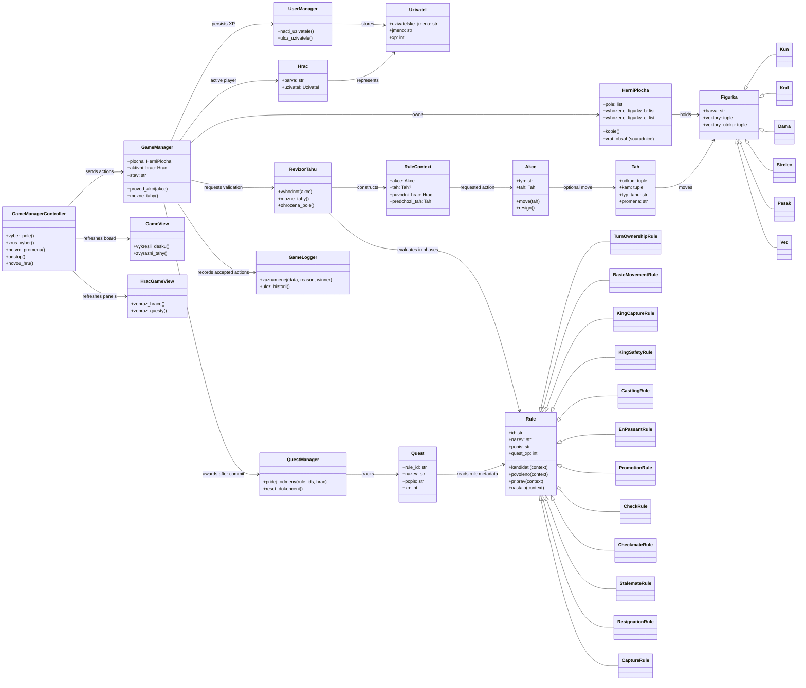
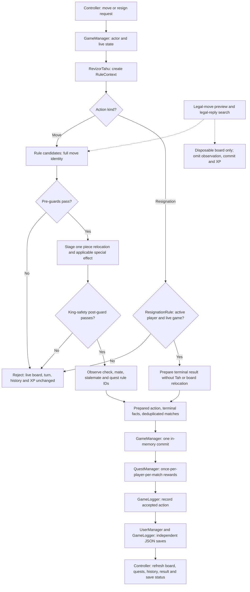
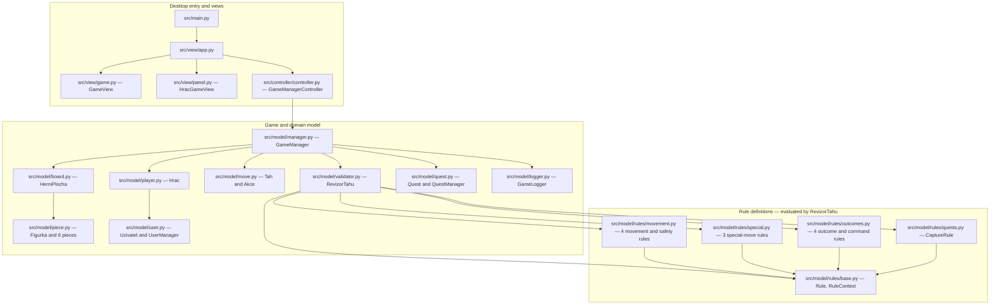

# BoardGamesWithQuests

**BoardGamesWithQuests** is an offline, two-player Chess desktop application with gameplay quests and persistent player XP. Two people share a computer, select local profiles, play on an interactive board, and earn experience points for recognizable Chess events. The application uses Python, Tkinter, and local JSON files, and runs from source or as a standalone Windows application.

## 1. Playing the game

### Starting a match

The application opens into a game setup view. Each participant selects an existing local profile or creates one by entering a username and display name. Usernames identify profiles; display names appear beside the board. The two seats use distinct profiles. Players assign one profile to **White** and the other to **Black** and select **New Game**.

The board opens at the standard Chess starting position, with 32 pieces, White at the bottom and White to move. Both player panels display the current username, name, XP rating, and available quests. The active player is clearly identified.

### Taking turns

1. The active player clicks one of their pieces. The selected cell and its legal destination cells receive distinct highlights.
2. Clicking a highlighted destination submits the move. Clicking a different owned piece changes the selection; clicking the selected piece again clears it.
3. If the move promotes a pawn, the interface requests a choice of queen, rook, bishop, or knight before the move is committed. Cancelling the choice keeps the board unchanged.
4. Once accepted, the board, captured pieces, history, quest indicators, active player, and status update from the same committed game state.
5. A rejected action leaves the existing position intact and presents an informative status message.

Both mouse and keyboard focus are visible. Game commands and profile controls are accessible in the main window; Control+Return starts a match from setup. Promotion uses a focused native dialog.

### Finishing and restarting

A game ends in **checkmate**, **stalemate**, or **resignation**. Checkmate and resignation identify the winning player; stalemate identifies a draw. The final board, result, and move history remain visible. Move interaction stops while the finished result is displayed. **New Game** creates a fresh match and refreshes per-match quest eligibility while preserving each profile's accumulated XP.

A match is a live session. The application preserves user profiles and a separate history file for each match; it opens new matches rather than restoring an unfinished board position.

## 2. Chess rules

### Board and coordinates

The board has eight ranks and eight files. In the model, positions use `(row, column)` integers ranging from `0` to `7`, where `row = 0` is Black's back rank, `row = 7` is White's back rank, and `column = 0` is file **a**. The display labels ranks **8–1** and files **a–h**. White's first rank holds rook, knight, bishop, queen, king, bishop, knight, rook from **a1** through **h1**; Black has the corresponding arrangement on rank 8. Each side has eight pawns on its second rank.

### Piece movement

| Piece | Movement and capture behavior |
| --- | --- |
| **King (`Kral`)** | One square in any direction. A king stays outside opposing attack squares. A king is never captured; checkmate decides victory. |
| **Queen (`Dama`)** | Any unobstructed number of squares along a rank, file, or diagonal. |
| **Rook (`Vez`)** | Any unobstructed number of squares along a rank or file. |
| **Bishop (`Strelec`)** | Any unobstructed number of squares diagonally. |
| **Knight (`Kun`)** | Two squares on one axis and one on the other; intervening pieces do not block its jump. |
| **Pawn (`Pesak`)** | One empty square forward, or two empty squares from its starting rank when both intervening and destination squares are clear. It captures one square diagonally forward; pawn attacks are independent of its forward moves. |

A move belongs to the active side, starts on one of its pieces, ends inside the board, respects occupancy and piece geometry, and leaves its own king safe. A standard capture removes exactly one opposing piece from its occupied destination. Captures and replacements update the appropriate captured-piece collection once. A move never directly captures a king.

### Castling

Castling moves the king two squares toward a same-color rook on its original square, with the rook landing immediately beyond the king on the other side. Castling is available when the chosen king and rook have not moved, all required spaces between them are empty, and the king's starting, transit, and destination squares are not under enemy attack. Kingside and queenside castling are supported. The king and rook each relocate exactly once, and the action produces a single move-history event.

### En passant

Immediately after an opposing pawn moves two squares from its starting rank, an adjacent pawn may capture it as though it had advanced one square. The capturing pawn lands diagonally forward on the empty square the opposing pawn passed through; the double-stepped pawn is removed from its actual square. Eligibility depends exclusively on the preceding accepted move and expires after the next turn. The capture is also subject to king safety.

### Promotion

A pawn reaching its final rank transforms into the acting player's chosen **queen, rook, bishop, or knight**. The same choices apply to quiet and capturing promotions. A promotion is one committed move with one replacement piece; the promotion choice is part of the immutable move identity.

### Check, checkmate, and stalemate

- **Check** means the side to move has a king attacked by the opponent. Legal moves resolve the attack without exposing the king to another attack.
- **Checkmate** means the side to move is in check and has no legal reply. The opponent wins.
- **Stalemate** means the side to move is not in check and has no legal move. The game is drawn.
- **Resignation** is an action by the active player that immediately awards victory to the opponent. It does not invent a coordinate move.

Attack-square calculation is based on piece attack geometry, obstacles, and special pawn attack vectors. It does not depend on whether the attacking side can legally move its king. Legal-reply searches apply candidate, permission, staged-effect, and king-safety checks without recursively evaluating terminal outcomes.

The implemented game-ending mechanisms are checkmate, stalemate, and resignation. The gameplay timer and tournament-adjudication systems are outside this product's rule set.

## 3. Profiles, quests, and XP

### Local profiles

A profile has a unique normalized username, display name, and nonnegative cumulative integer **XP**. Username normalization removes leading and trailing whitespace and compares case-insensitively; different spellings resolving to the same normalized key identify the same profile. Display names retain the player's chosen presentation. Each match assigns exactly one profile to each color. The displayed rating is cumulative quest XP, rather than Elo.

### Quests

Six quests are derived directly from the corresponding gameplay `Rule` objects. Their names, descriptions, stable rule identifiers, and `quest_xp` rewards are defined by those rules and exposed as `Quest` views.

| Quest | Event on an accepted move | XP |
| --- | --- | ---: |
| **Capture** | An opposing piece is captured | 10 |
| **Castling** | A legal castle is completed | 15 |
| **En passant** | A legal en-passant capture is completed | 20 |
| **Promotion** | A pawn is promoted | 25 |
| **Check** | The move leaves the opposing king in check | 10 |
| **Checkmate** | The move delivers checkmate | 50 |

Each quest awards XP **once to each player profile per match**. A single accepted move can satisfy several distinct quests simultaneously. For example, a first en-passant capture earns Capture and En passant rewards, and a first checkmating move can earn Check and Checkmate rewards. Each quest is awarded only if that acting player has not already completed it in the current match.

`QuestManager` stores the set of awarded `(profile, rule_id)` pairs for the active match. It receives matched rule identifiers from the validator **after the accepted action commits**; it does not independently reevaluate Chess rules. XP is attributed to the original acting player even after turn advancement. A new match clears completion tracking and retains the user's cumulative XP.

The player panels show all six quests, their XP values, and each player's current completion state. The game supplies a short completion message and the points awarded by an accepted action.

## 4. Desktop interface

The graphical application uses one Tkinter root window with game setup and active-match interfaces. Focused native dialogs handle promotion choices and confirmation of resignation, new games, and player changes. The Chess board is an **8×8 grid of `tk.Button` widgets**. Cells display Unicode Chess symbols with a font fallback that keeps piece colors and identities legible. White is displayed at the bottom throughout the match.

The active-match layout contains:

- A board with rank/file labels, selected-square highlighting, legal-destination highlighting, and a clear active-turn indicator.
- Two reusable player panels (`HracGameView`), one for each color, with usernames, display names, cumulative XP, and the six quest states.
- A chronological move-history view containing every accepted move and terminal action.
- A status area for check, terminal result, illegal-action feedback, quest awards, and independent persistence warnings.
- Controls for starting a match, clearing selection, choosing promotion, resigning with confirmation, and retrying eligible failed saves.

Selection and pending promotion are ephemeral UI/controller states. Views read the current committed match snapshot and never mutate game rules directly. The same interface handles ordinary play, special moves, terminal outcomes, and local storage feedback.

### Interaction details

| User action | Interface response |
| --- | --- |
| Click an active-side piece | Select it and highlight its legal destination cells. |
| Click another active-side piece | Replace selection and destination highlights. |
| Click a legal destination | Commit the move, or show promotion choices when applicable. |
| Click an invalid destination | Preserve the game; show feedback and keep interaction predictable. |
| Choose a promotion piece | Commit the selected promotion variant. |
| Cancel promotion or resignation | Preserve the live position; cancelling promotion also clears the pending selection. |
| Resign as the active player | End the match, record the winner, and show the result. |
| Start New Game | Create a new match with fresh turn, history and quest progress. |
| Retry a failed save | Write the latest eligible profile or history snapshot and update its own status. |

## 5. Domain architecture

The application separates domain state, rule evaluation, controller input, views, and local persistence.

| Component | Ownership |
| --- | --- |
| `GameManager` | Sole authority for the active board, participants, active turn, status and result; commits each accepted action once. |
| `HerniPlocha` | Board cells, copied staging boards, square queries, captured-piece collections, relocation and replacement. |
| `Figurka` and six named subclasses | Piece identity, color, movement vectors, attack vectors, and jump traits. |
| `Tah` | Immutable coordinate move with origin, destination, move kind, and optional promotion choice. |
| `Akce` | Immutable user request containing either a `Tah` or the non-coordinate resignation kind. |
| `RevizorTahu` | Ordered evaluation of Python `Rule` objects, legal-move queries, candidate staging, safety and event observation. |
| `Rule` / `RuleContext` | Named, stateless rule behavior and immutable action facts; rule IDs also identify quest events. |
| `Quest` / `QuestManager` | Quest presentation and once-per-player-per-match XP awards from post-commit matches. |
| `Uzivatel` / `Hrac` / `UserManager` | Profile identity, assigned piece color, cumulative XP and profile storage. |
| `GameLogger` | Ordered accepted-action history, previous accepted move and per-match JSON files. |
| `GameManagerController` | Piece selection, promotion choice, action submission and view refresh. |
| `GameView` / `HracGameView` | Board interaction/display and reusable player/quest presentation. |

The primary domain class names preserve the Czech naming of the educational object model. Supporting names and source modules use focused conventional Python identifiers.

### Class UML

<!-- The diagram is part of the product's source-level architecture contract. -->



### Rule registry

The fixed, ordered rule registry contains twelve concrete Python classes. The validator evaluates each rule through only the phases that are relevant to that rule.

| Rule | Responsibility | Quest XP |
| --- | --- | ---: |
| `TurnOwnershipRule` | Confirms the acting player, piece ownership, and live match status | 0 |
| `BasicMovementRule` | Generates ordinary move candidates from piece vectors and board occupancy | 0 |
| `KingCaptureRule` | Prevents moves that capture a king | 0 |
| `KingSafetyRule` | Rejects staged moves leaving the acting king attacked | 0 |
| `CastlingRule` | Generates eligible castling variants and their rook relocation | 15 |
| `EnPassantRule` | Generates eligible en-passant variants and removal of the bypassed pawn | 20 |
| `PromotionRule` | Generates promotion variants and their chosen piece replacement | 25 |
| `CheckRule` | Observes that the resulting opponent's king is attacked | 10 |
| `CheckmateRule` | Observes an attacked opposing king with no legal reply | 50 |
| `StalemateRule` | Observes an unattacked opposing king with no legal reply | 0 |
| `ResignationRule` | Validates the active player's resignation and creates a terminal result | 0 |
| `CaptureRule` | Observes a completed capture | 10 |

`Rule` provides a stable `id`, `nazev`, `popis`, and integer `quest_xp`, together with phase-specific hooks:

- `kandidati(context)`: proposes complete coordinate move variants where applicable;
- `povoleno(context)`: answers a permission/guard question when this rule constrains the action;
- `priprav(context)`: describes a compatible change to a disposable board;
- `nastalo(context)`: identifies an observed event on an otherwise legal prepared result.

The hooks have **different semantics**: a failed permission guard rejects an action, whereas a false observation simply means that event did not occur. Unused phase hooks contribute no restrictions or changes. Rules inspect facts and propose effects; they do not commit live state, change XP, or write files. The base class supports concrete subclasses using only their relevant hooks, without requiring redundant logic.

`RuleContext` contains the immutable requested `Akce`, optional `Tah`, original acting `Hrac`, previous accepted coordinate move, and the relevant original or staged position supplied by the validator. Resignation has no `Tah` and follows its own rule branch.

### Action lifecycle

1. **Request:** The controller submits a move or resignation `Akce`. `GameManager` identifies the actor and live match.
2. **Candidates:** For moves, the validator generates and matches complete move identities: origin, destination, move kind, and promotion choice. Ordinary and special candidates enter the same evaluation pipeline.
3. **Pre-validation:** Applicable permissions check the acting player, owned piece, candidate eligibility, square bounds, occupancy, and prohibited king capture.
4. **Staging:** The validator creates a disposable board. It relocates the moving piece **exactly once**, applies any ordinary capture once, and applies the one appropriate special supplement: rook relocation, en-passant victim removal, or selected promotion replacement.
5. **King safety:** The validator examines the staged position, including castling's starting and transit squares where applicable. Unsafe moves are rejected without altering live state.
6. **Observation:** The prepared position is inspected for capture, check, checkmate, stalemate, and the quest-eligible rule IDs. Observation neither replays movement nor writes rewards. Matched IDs are deduplicated.
7. **Commit:** `GameManager` publishes one accepted board/turn/result transition. A resignation instead commits its terminal result without any board relocation.
8. **Rewards and record:** `QuestManager` awards eligible matched quests to the original actor once; `GameLogger` appends the accepted move or terminal event. The profile and history stores independently attempt their JSON saves.
9. **Refresh:** The controller displays the current board, panels, history, result, and individual save statuses.

**Legal-move previews** and **legal-reply searches** run only the candidate, permission, disposable staging, and king-safety parts of this pipeline. Raw attack-square queries use a nonrecursive helper; terminal observation, commits, XP, and disk writes are absent from previews. Invalid and cancelled actions leave the committed board, turn, XP, and history unchanged.

### Move and action flow



## 6. Local data

Profiles and match histories are distinct JSON documents under a writable, per-user application-data directory. Runtime resources and packaged application files remain read-only. All stored user identifiers and match identifiers are data values rather than user-supplied file paths.

### Profile store

`UserManager` keeps normalized usernames as unique keys, with a display name and cumulative XP. It saves profiles when they are created or their XP changes and reloads successfully saved profiles when the application starts. The format is versioned:

```json
{
  "schema_version": 1,
  "users": {
    "alice": {
      "username": "alice",
      "display_name": "Alice",
      "xp": 35
    }
  }
}
```

The profile key and `username` are normalized using trimmed, case-insensitive identity comparison. The displayed XP is a nonnegative integer. Quest completion sets are **match-local state** rather than permanent profile history.

### Match history

`GameLogger` assigns a unique match ID, maintains an ordered list of accepted events, and writes one file per match, such as `data/logs/<match-id>.json`. Accepted move entries include their acting profile, origin and destination, move kind, promotion choice if any, capture details, matched rule IDs, awarded XP, and their order. Resignation has a terminal event without coordinates. A match record contains the participating profiles, colors, match status, result reason, and optional winning profile.

The JSON record follows this shape (illustrative values):

```json
{
  "schema_version": 1,
  "match_id": "7f4bf233-8449-4262-9a94-9d9f63a6e211",
  "players": { "white": "alice", "black": "bob" },
  "events": [
    {
      "index": 1,
      "type": "move",
      "actor": "alice",
      "from": [6, 4],
      "to": [4, 4],
      "move_kind": "pawn_double",
      "promotion": null,
      "capture": null,
      "matched_rule_ids": [],
      "xp_awarded": 0
    }
  ],
  "status": "in_progress",
  "result": { "reason": null, "winner": null }
}
```

The file reflects the latest accepted action and eventual terminal result. The runtime history also supplies the last accepted coordinate move for en-passant eligibility. Saved history is readable as JSON, while the current match remains a live in-memory session.

### Saving and recovery

Each target file uses a temporary sibling file followed by `os.replace()` for an individual atomic replacement. Profile and match-history writes have **independent** success/failure statuses; they are not a multi-file transaction.

- A successful save clears that file's unsaved warning.
- An ordinary write error retains the accepted in-memory state, marks the affected target as unsaved, and offers a retry of its latest snapshot.
- An invalid or malformed existing JSON file stays intact. The application displays a recovery warning, uses clean in-memory defaults for that store, and blocks replacement of the damaged target until the file is repaired or moved aside by the user. On Retry, the store rechecks the repaired or removed file; a valid, nonconflicting version can be saved without restarting the application. Recovered profile records are merged with the active in-memory profiles, and conflicting identities block the write rather than silently overwriting either copy. Repaired match histories must belong to the active match and agree with its recorded event prefix.
- Profile saves use a cooperative per-directory lock and an observed-content fingerprint. If another instance changed a valid profile file since this instance loaded or last saved it, the stale instance refuses to overwrite it. The saved file and unsaved in-memory XP remain intact, and the UI exposes a conflict warning. This lock coordinates participating application instances, not unrelated tools that ignore it.
- Profile and history storage failures are reported independently. In-memory state remains playable while writable persistence is unavailable; changes that remain unsaved can be lost when the program closes.

## 7. Source layout

The Python application uses **19 source modules**, grouped by model, rules, controller, and views. The `src/main.py` module starts the Tkinter application. Domain objects remain independent of Tkinter and filesystem UI widgets.

| Module | Primary contents |
| --- | --- |
| `src/main.py` | Application startup |
| `src/model/user.py` | `Uzivatel`, `UserManager` |
| `src/model/player.py` | `Hrac` |
| `src/model/board.py` | `HerniPlocha` |
| `src/model/piece.py` | `Figurka`, `Kun`, `Kral`, `Dama`, `Strelec`, `Pesak`, `Vez` |
| `src/model/move.py` | `Tah`, `Akce` |
| `src/model/manager.py` | `GameManager` |
| `src/model/validator.py` | `RevizorTahu` |
| `src/model/quest.py` | `Quest`, `QuestManager` |
| `src/model/logger.py` | `GameLogger` |
| `src/model/rules/base.py` | `Rule`, `RuleContext` |
| `src/model/rules/movement.py` | `TurnOwnershipRule`, `BasicMovementRule`, `KingCaptureRule`, `KingSafetyRule` |
| `src/model/rules/special.py` | `CastlingRule`, `EnPassantRule`, `PromotionRule` |
| `src/model/rules/outcomes.py` | `CheckRule`, `CheckmateRule`, `StalemateRule`, `ResignationRule` |
| `src/model/rules/quests.py` | `CaptureRule` |
| `src/controller/controller.py` | `GameManagerController` |
| `src/view/app.py` | Root window and setup/navigation layout |
| `src/view/game.py` | `GameView` and the `tk.Button` Chess board |
| `src/view/panel.py` | `HracGameView` and player/quest panels |

### Module dependency map



## 8. Running and distribution

BoardGamesWithQuests is a desktop application for Windows with a local Python source distribution and a standalone Windows executable. The standalone executable includes its Python runtime and its required application resources, so using the application does not require a separately installed interpreter. Runtime profile and history files are placed in user-writable storage, rather than next to packaged program files.

The application runs offline. The user interface, rule definitions, quests, profile data, and saved match histories are local to the computer. The repository includes the Python source, this product description, and the diagrams for the class model, action lifecycle, and module layout.
