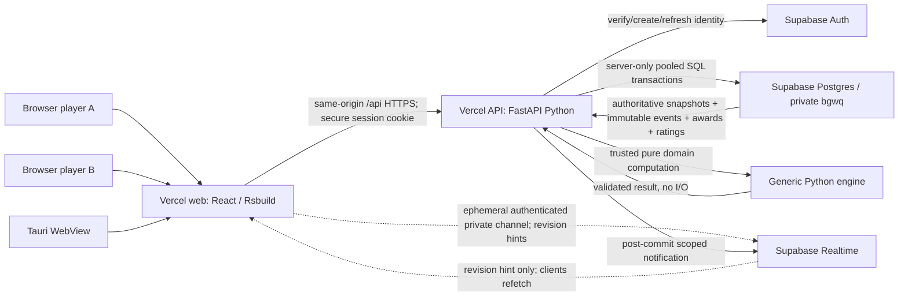
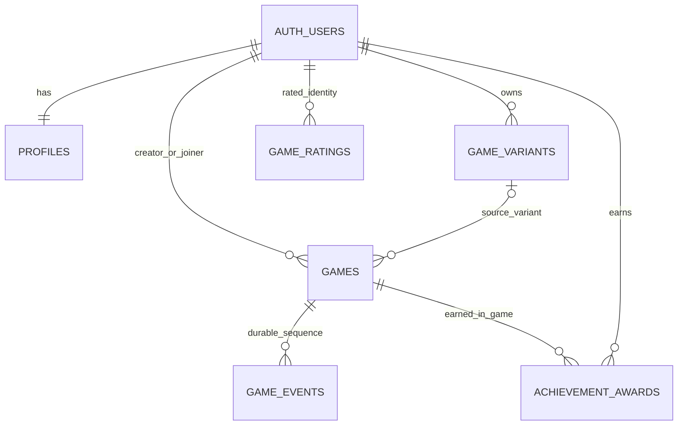

# BoardGamesWithQuests — Complete Product and Implementation Contract

> **Contract state: PROPOSED — requires maintainer design approval.** This document specifies one complete build-from-zero target and a separate, evidence-based repository migration. It is not evidence that any component works, and it does not authorize deployment, database deletion, merging, or paid resource use. Sections marked **DECISION** must be ratified before their dependent implementation. Implementers may not fill architectural gaps autonomously.

## 0. Authority, interpretation, and completion

**One implementation contract.** This file is the canonical product, architecture, interface, persistence, security, delivery, and migration specification once approved. Source-controlled JSON schemas, migration SQL, tests, diagrams, generated types, OpenAPI, package manifests, CI, and documentation are executable/derived artifacts of this contract, not competing design authorities. Supporting specifications and the supplied reference UML may be retained as technical evidence, but any contradictory requirement must be reconciled within the same PR that establishes this contract; do not preserve competing plans.

**Two perspectives are mandatory and separate:**
1. **Greenfield target (sections 1–16):** sufficient to implement the full product in a fresh repository and fresh Supabase/Vercel projects, without looking at legacy code or prior issues.
2. **Repository/infrastructure delta (sections 17–19):** precise actions to transform the identified branches, files, migrations, hosted resources, workflows, issues, and PRs into that target without destructive shortcuts.

**Normative words:** MUST = release-blocking; MUST NOT = prohibited; SHOULD = recommended unless explicitly justified and reviewed; **DECISION** = proposal requiring explicit maintainer agreement. Every behavior MUST have a stable contract, observable acceptance scenario, and responsible package. A feature that merely parses, compiles, displays a placeholder, or runs against mocks is not implemented.

**Invariants:**
- Exactly two **different, provider-verified human participants** occupy the two slots of an active game; pending games have only a creator.
- Python is the single trusted, game-neutral rules engine. **All** authored board/piece/rule/quest/clock behavior is bounded declarative JSON; no executable Python/JavaScript supplied by players.
- The database owns persistence, atomicity, ordering, and concurrency; the API owns credential verification and request authority; the engine owns legal domain decisions. The browser and desktop wrapper own only rendering and ephemeral interaction state.
- Every game/session, definition, clock, event, quest progress, reward, rating, history entry, and user-owned variant is reconstructible from the service after refresh, new client, network interruption, or serverless restart. A credential cookie is **not** game-state persistence.
- No separate rooms, matchmaking queue, AI opponent, leaderboard, marketplace, tournaments, spectators, chat, social feed, duplicate desktop product, Python UI, arbitrary scripting, or disposable bootstrap paths.
- Zero paid infrastructure, privileged browser secrets, automatic merging, fabricated green checks, or modification of unrelated hosted account records.
- No intermediate/parallel implementations of the same responsibility. Every merged PR must leave coherent final interfaces; remove superseded behavior in the same PR.
- No obsolete chronology, migration storytelling, dated progress, or “current vs old” wording in steady-state source/docs. The explicitly requested **migration delta** and immutable technical migration identifiers are exceptions to that content rule.
- A change is not complete until **all** related contracts, fixtures, generated artifacts, tests, docs, links, workflows, migrations, and release conditions agree.

### 0.1 Release definition

**Public acceptance:** Two separately authenticated browsers can discover or create a game, one creates and another joins, complete a legal game of **orthodox chess**, **English draughts**, and **international draughts**, persist every accepted action, withstand reload/reconnect/conflict/restart, correctly adjudicate clocks/quests/results/ratings, and export supported formats. The same hosted website runs inside a working Tauri desktop wrapper.

**Classroom acceptance:** at least **30 distinct players / 15 concurrently active two-player games**, including guest access from a shared school IP, complete verified play and reconnection under the authorized free-tier capacity; any provider quota blocker is reported as **BLOCKED**, not silently downgraded or paid around.

**Final approval:** independent functional, security, and deployment evidence; green required checks; verified public URLs; no unresolved blocking review comments; explicit maintainer authorization to merge.

## 1. User workflows and visible product

### 1.1 Identity and account
- A visitor opens the public site and chooses **Continue as guest** or **Register / Sign in**. Guest = genuine anonymous Supabase Auth user, not a shared public API key or fabricated local UUID.
- Guests supply a display nickname. Registered accounts have provider-owned authentication and a profile containing display name and optional unique username. Any editable public profile field is validated and never authorizes a game action.
- The app restores the **same authenticated identity** after ordinary refresh/browser restart while its valid server-issued credential remains. Logging out revokes/clears it. Losing all credentials for an unlinked anonymous account may make that identity unrecoverable; the game still persists for the other player and in history.
- Guest-to-registered conversion MUST preserve the **same** Auth user UUID and all associated games, awards, experience, and ratings; only advertise conversion flows actually supported and verified by the provider. No client-assigned identity merges.
- The signed-in user can view their own finished/active games, earned achievements and experience, and ratings. No global leaderboard.

### 1.2 Definitions and configuration
- Built-ins: **Chess** (initial selection), **English Draughts** (8×8), **International Draughts** (10×10).
- The player can view a built-in definition, duplicate it as a **user-owned variant**, name it, edit it through forms, save, duplicate, rename, and delete their own variant. Built-ins cannot be edited or deleted.
- Settings has one explicit definition selector and **Board / Pieces / Rules / Quests / Clocks** sections. The rule/quest builder exposes the whole supported typed condition/query/effect language through validated forms; it is not a source-code editor.
- Save performs server-side validation and optimistic revision checking. Invalid/over-budget/unowned definitions are rejected with actionable field-level errors; the last valid saved document survives.
- A game pins the chosen **complete validated JSON and hash at creation**. Editing/deleting a source variant cannot mutate existing games. New games use the latest saved variant revision.

### 1.3 Two-player game lifecycle
1. Creator chooses built-in/variant and time control, then **Create game**.
2. Server creates a pending game containing one creator, immutable selected definition and a shareable unguessable game URL/ID. This **is the game**, not an additional room.
3. A distinct authenticated player opens that URL, sees only minimal invitation metadata, and chooses **Join**. One atomic transaction claims the second slot; self-join or simultaneous third join fails safely.
4. On join, initialize the entire authoritative session, server clock, first turn, configured rules/quests and genesis history. Both players see the same game.
5. Each sees their side, board orientation/coordinates, selectable legal moves, promotion choices, capture paths, both clocks, player names, captures, move history, quest progress, results, connection state, and clear errors. No unilateral client alteration of any of these values.
6. A proposed move is sent with expected revision and unique action ID. Only a verified active participant can commit one legal complete move; losers in a race receive an authoritative conflict and refresh.
7. Refresh/new device (after authenticated login), reconnect, missed notification or function restart hydrates from service and reconciles events; a stale client never “replays” local actions as if accepted.
8. Resign, valid configured draw claims, agreed draw, and clock expiry close the game atomically. Finished games become read-only but history/export/account records remain available.
9. A pending game expires after **24 hours without a join (DECISION)**; expiry is evaluated from trusted database time on normal requests, without requiring a paid scheduler. No automatic deletion of finished games.

### 1.4 Presentation
- Responsive React UI, with accessible keyboard interaction, touch, readable focus states, screen-reader descriptions of board squares/pieces/actions, disabled controls where the actor cannot act, and mobile layout.
- Coordinates, symbols, colors, promotion choices, sizes and piece semantics derive from definitions, not piece-name switches embedded in React.
- The provided GUI mockup in `.agents/notes/GUI_mockup.svg` is a visual reference; behavior and responsiveness are defined here. Do not fabricate an unrelated new product design.
- Web and desktop share **one build and one HTTPS origin**. Tauri is a WebView wrapper only; local client storage never becomes an authoritative game database.

## 2. Final runtime topology and authority



**Runtime ownership:**

| Concern | Single authority | Allowed dependent representations |
| --- | --- | --- |
| Credentials / account identity | Supabase Auth `auth.users` | HttpOnly session credential, verified API identity, transient Realtime token |
| Profile / variants / achievements / experience / rating | Private Postgres `bgwq` | Authenticated API projections and ephemeral UI |
| Definition semantics / legal actions / result / quest adjudication | Trusted generic Python engine | Pinned validated JSON, engine result returned to API |
| Game participation / lifecycle / action order / clocks / durable state / history | Postgres transactions with engine-supplied legal transition | Read-only participant-scoped API snapshots |
| Participant authorization / request origin / transport / provider validation | FastAPI host with provider-confirmed identity | No trust in client-provided UUID, state, result, clock or award |
| Notification delivery | Private Supabase Realtime | Untrusted “revision changed” hints only; ordered data is refetched |
| Interaction / layout / transient selections | React website | Local view state, optimistic **visual** feedback only |
| Desktop packaging / navigation | Tauri | Loads the same verified website |

**Persistence invariant:** At every commit, `games.snapshot.revision = games.revision = highest committed domain event revision` and the snapshot/hash agree with the event chain. Server memory, WebSocket transport, browser storage, React component state, and a running Python process may all disappear without losing the session.

**API/web origin:** two Vercel projects: one builds `packages/web` and the other exposes the Python ASGI application. Browser requests use **web-origin `/api/*` rewrites/proxy** to the API deployment. This makes secure cookies, Tauri remote origin, CSRF policy and CORS tractable. The API MUST reject unauthorized cross-origin mutation; the public API deployment must not be an unprotected bypass. Deploy the web/API pair from compatible Git revisions. **DECISION:** review the exact Vercel rewrite/domain arrangement and Auth cookie design before coding.

**Python runtime:** Vercel Python Functions with stateless instances; shared generic engine imported by FastAPI. Direct Postgres connection via supported **Supabase transaction pooler**, secure server-side credential, strict connection/statement timeouts. No always-on Python host, background memory worker, custom realtime game authority, or server-side code executed from user JSON.

## 3. Final source tree and package contracts

```text
.
├── .agents/
│   ├── AGENTS.md                 # generic engineering governance only
│   ├── SCRATCHPAD.md             # ephemeral execution notes, not architectural authority
│   └── notes/
│       ├── PLAN.md               # THIS canonical contract (single copy)
│       ├── GUI_mockup.svg
│       ├── reference_diagram.md
│       └── diagrams/
│           ├── reference-page1.svg
│           ├── reference-mvc.svg
│           └── generated/       # generated architecture diagrams (not independently edited)
├── .darkfactory/
│   └── installation.json         # generated managed installation receipt
├── .github/
│   ├── workflows/                # thin pinned orchestration + native product checks
│   ├── scripts/                  # ONLY repository/GitHub/docs/build automation
│   ├── ISSUE_TEMPLATE/
│   └── PULL_REQUEST_TEMPLATE.md
├── api/
│   └── index.py                  # required thin Vercel ASGI adapter, NO business logic
├── packages/
│   ├── engine/                   # headless Python generic JSON parser/evaluator/domain
│   │   ├── model/game/           # session, transitions, geometry, effects, clocks, quests
│   │   ├── model/pieces/         # generic piece representation only
│   │   └── model/misc/           # shared generic utilities only
│   ├── chess/                    # shipped config.json + chess-owned export writers
│   │   ├── config.json
│   │   └── export/
│   ├── english_draughts/         # shipped config.json + own exporters, if supported
│   │   └── config.json
│   ├── international_checkers/   # shipped config.json + own exporters, if supported
│   │   └── config.json
│   ├── server/                   # FastAPI, Auth, transport contracts, SQL adapter
│   │   ├── app.py
│   │   ├── auth.py
│   │   ├── api/                  # versioned routers and typed request/response schemas
│   │   └── persistence/          # DB transactions, integrity, scoped read projections
│   ├── web/                      # Bun, Rsbuild, React, TypeScript, Biome
│   │   ├── src/
│   │   │   ├── api/              # generated typed contract + fetch/session handling
│   │   │   ├── auth/
│   │   │   ├── games/
│   │   │   ├── settings/
│   │   │   └── components/
│   │   ├── package.json
│   │   └── bun.lock
│   └── desktop/                  # Tauri 2 network WebView, no duplicate UI
│       └── src-tauri/
├── supabase/
│   ├── config.toml               # reviewed CLI local project config
│   └── migrations/
│       └── <CLI-generated>_initial_bgwq_schema.sql
├── tests/                         # ONLY project behavior/integration/e2e tests and fixtures
│   ├── fixtures/                  # JSON/SQL scenarios colocated with consumers
│   ├── contract/
│   ├── api/
│   ├── provider/
│   ├── browser/
│   └── desktop/
├── pyproject.toml                 # native required packaging metadata
├── mkdocs.yml                     # native required docs tool metadata
├── vercel.json                    # compatible API/web deployment routing, if necessary
├── repo.dfconfig                  # sole editable DarkFactory consumer configuration
├── README.md
├── CONTRIBUTING.md
└── LICENSE
```

The tree is **semantic**: package subdirectory names may be refined without changing responsibilities, but the exact interfaces below may not silently change. **Exactly one** plan lives at `.agents/notes/PLAN.md`; do not materialize an alternate path. Python package initialization files are permitted only where a runtime side effect truly requires them; prefer verified namespace-package discovery, including built-wheel resource loading. The obligatory Vercel root adapter may exist **only** if validated packaging/deployment requires it; it must import and expose the real `server.app`, not duplicate endpoints. No `src/` game container, old `checkers/` catch-all, separate Python editor, standalone `scripts/` testing home, or empty placeholder packages.

## 4. Supabase ownership and exact logical database model — DECISION GATE

**Provider:** one managed Supabase project or reproducible replacement, native `auth.users` and private `bgwq` schema. `public` exposes **no authoritative application tables**. No duplicate `users` table and no game-specific direct writes from browser roles.

**Proposed final ERD (not approved until jointly reviewed):**



**Exactly these six project-owned tables are proposed**: `profiles`, `game_variants`, `games`, `game_events`, `achievement_awards`, `game_ratings`. Per-player **in-game quest progress lives in the canonical `games.snapshot`**, not an independently mutable `game_quest_results` table. Projected quest cards are calculated from the snapshot. This explicitly resolves the competing-source-of-truth problem; add a read projection table only if measurements prove it necessary and the maintainer approves it.

### 4.1 Table definitions (normative proposal)

**`bgwq.profiles`**
- `user_id uuid PRIMARY KEY REFERENCES auth.users(id) ON DELETE RESTRICT`.
- `display_name text NOT NULL` (trimmed 1–64 visible characters), `username text NULL` (normalized 3–32 constrained characters; case-insensitive unique when present), `created_at` and `updated_at` timestamptz NOT NULL.
- No password, locally issued UUID, mutable XP total or direct account-rating scalar. Auth account is the stable identity, including for guests.

**`bgwq.game_variants`**
- `id uuid PRIMARY KEY`; `owner_id uuid NOT NULL REFERENCES auth.users(id) RESTRICT`; `base_definition_key text NOT NULL`; `name text NOT NULL` (1–80); `schema_version int NOT NULL`; `definition jsonb NOT NULL`; `definition_digest bytea NOT NULL` (SHA-256 of canonical validated definition); `revision bigint NOT NULL DEFAULT 1`; timestamps.
- Unique `(owner_id, normalized_name)`, nonempty validated definition, monotonic revision on edits, server-enforced size/depth/operation limits. `PATCH` with expected revision is compare-and-swap. Owner may delete their variant; pinned game snapshots remain intact.
- No executable code, embedded credential, shared ownership or variant runtime override.

**`bgwq.games`**
- `id uuid PK`; `creator_id uuid NOT NULL FK auth.users RESTRICT`; `joiner_id uuid NULL FK auth.users RESTRICT`; `created_action_id text NOT NULL`; `join_action_id text NULL`; `source_variant_id uuid NULL` (nullable FK with deletion behavior that retains the immutable pin; **DECISION**: use `ON DELETE SET NULL`); `definition_key text NOT NULL`; `config_snapshot jsonb NOT NULL`; `config_digest bytea NOT NULL`; `lifecycle text NOT NULL` IN `pending, active, finished, expired`; `snapshot jsonb NULL`; `snapshot_digest bytea NULL`; `revision bigint NOT NULL DEFAULT 0`; `created_at, updated_at, started_at, finished_at, pending_expires_at, rating_settled_at` timestamptz with lifecycle-dependent nullability; `result jsonb NULL`.
- Unique `(creator_id, created_action_id)`; `creator_id != joiner_id` when joined. Pending = `joiner_id IS NULL`, `snapshot IS NULL`, `revision=0`, no game clock. Active = both participants distinct, valid snapshot/clock, null result. Finished = both participants, result matches snapshot and final event, no new gameplay actions. Expired = never-activated pending match, no invented terminal score.
- Immutable `creator_id, definition_key, config_snapshot, config_digest, created_action_id`; `joiner_id` can change exactly once, from NULL to verified distinct user at activation. Client cannot supply `snapshot` or `result`.
- A game with a configured terminal starting position is either correctly terminal at activation via engine evaluation or refused; it cannot be presented as active and unplayable.

**`bgwq.game_events`**
- `game_id uuid NOT NULL REFERENCES games(id) RESTRICT`, `revision bigint NOT NULL` (activation event = 0, domain actions = 1..N), `actor_id uuid NOT NULL REFERENCES auth.users(id) RESTRICT`, `scope text NOT NULL` IN `activation, domain`, `action_id text NOT NULL` (1–128), `request_digest bytea NOT NULL`, `payload jsonb NOT NULL`, `previous_state_digest bytea NULL`, `state_digest bytea NOT NULL`, `committed_at timestamptz NOT NULL`.
- PK `(game_id, revision)`, unique `(game_id, scope, action_id)`; actor/request digests MUST match on idempotent retries and fail on conflicting reuse. The activation envelope at revision 0 is mandatory for every playable match. `created_action_id` has its separate creator-scoped uniqueness in `games`.
- Append-only: revoke UPDATE/DELETE from application roles, prevent mutation in privileged transaction paths; never truncate accepted transcripts. State digests bind every committed event and snapshot. Canonical serialized bytes MUST use **RFC 8785 JSON Canonicalization Scheme (JCS)** over validated, finite JSON, with no undefined or non-JSON values; digests are binary SHA-256 of those bytes. The event payload's own `state_digest` is excluded from the hashed snapshot to prevent recursion. Maintain public deterministic digest test vectors shared by Python, SQL checks and TypeScript.

**`bgwq.achievement_awards`**
- `id uuid PK`; `source_game_id uuid FK games RESTRICT`; `user_id uuid FK auth.users RESTRICT`; `quest_id text NOT NULL`; `points integer NOT NULL CHECK (points >= 0)`; `earned_at` timestamptz; unique `(source_game_id, user_id, quest_id)`.
- Created solely in the same accepted domain action/terminal transaction that causes completion. XP = `SUM(points)` over award rows for that account. No awards from a rejected, duplicate or forged action; no duplicates on replay or retry.

**`bgwq.game_ratings`**
- `user_id uuid FK auth.users RESTRICT`; `ruleset_id text NOT NULL`; `rating integer NOT NULL`; `played integer`, `wins integer`, `draws integer`, `losses integer` (all nonnegative); `last_game_id` nullable FK games; timestamps; PK `(user_id, ruleset_id)`.
- Ruleset identity is a stable built-in definition key **and** versioned rules digest; custom variants use their canonical ruleset digest, so altered rules cannot manipulate an unrelated rating. Initial rating **1200**, two-player Elo **K=32**: compute `expected_A = 1/(1 + 10**((rating_B - rating_A)/400))` from both **pre-game** ratings, `delta_A = round_half_away_from_zero(32 × (score_A - expected_A))` for score `1` (win), `0.5` (draw), `0` (loss); set `delta_B = -delta_A` for zero-sum updates. Apply once per accepted terminal result **(DECISION)**. Update **both** participants in one serializable/locked transaction, once per finished game, and never via client inputs. No leaderboard endpoint/table. Match terminal processing MUST set `games.rating_settled_at` in the **same** commit as the terminal event and both rating updates; it is NULL until rated settlement, and prevents a second application.

### 4.2 Database constraints and privileges
- All project tables in private `bgwq`; enable RLS as defense in depth, no `USAGE` / `SELECT` / `INSERT` / `UPDATE` / `DELETE` / function `EXECUTE` to browser `anon`/`authenticated` roles. No publicly executable privileged stored procedure. DB access only from the trusted API through least-privileged server credentials using the provider-supported pooler.
- Realtime uses **private authenticated broadcast channels**, with independently tested participant membership policy on `realtime.messages` or an equivalent provider-supported private transport; do **not** expose private game tables as public Realtime Postgres Changes. No broadcast of private snapshot, credentials, or a mutable command. Realtime is optional to correctness; polling/refetch reconciles outages.
- Foreign keys to `auth.users` must not imply grants to read Auth, cascade-delete other users' data, or modify Supabase-managed system schemas.
- Enforce constraints at DB boundary even when API validates: JSON object type, digest lengths, UUID FKs, lifecycle/participant relationships, unique idempotency scopes, expected revision, snapshot/result coherence, and valid timestamps.
- Unique claims and locking design must be verified under concurrent independent DB connections; a single-process mutex is never sufficient.

## 5. Transaction, lifecycle, idempotency, clocks, recovery

### 5.1 Create
- Authentically resolve creator; select verified built-in/owned variant; reject non-playable definitions; validate complete JSON and canonical digest; generate opaque game UUID on server.
- Persist pending row and creator/action key atomically; exact duplicate creation returns the original game ID and immutable selection; conflicting reuse produces `409`.
- Shareable game ID is unguessable; invitations reveal only bounded non-sensitive metadata before joining. No room table, join code store, or third player slot.

### 5.2 Join/activation
- Authentically resolve joiner (distinct from creator). Open a DB transaction, lock pending row, enforce not expired and empty second slot, pin server time, compute engine initial session, and **in the same transaction** set joiner, active lifecycle, initialized snapshot/revision 0, and append immutable activation event.
- Two racing joins: at most one succeeds, the other receives conflict. Exact retry by the accepted joiner returns the same activation result, no second event. First active clock anchor uses DB-trusted timestamp after claiming the row.

### 5.3 Domain action commit
1. Accept only authenticated request containing `expected_revision`, `action_id`, and a **closed, validated action intent**; reject any client-provided post-state, award, actor UUID, winner, server time or event envelope.
2. Start server-only DB transaction through transaction pooler; set bounded lock/statement timeout; lock `games` row. Check lifecycle and membership; check existing idempotency key **before** treating an exact retry as stale or terminal; return previously accepted result iff actor + intent + expected revision + digest match.
3. Ensure expected revision is latest; obtain **database-trusted clock time after acquiring lock**; deserialize validated pinned configuration and canonical snapshot.
4. Invoke pure Python engine once with actor, immutable authoritative state, action, and trusted timestamp; recompute legal candidates, clocks, hooks, quest state, outcome and next snapshot. Reject without mutation if invalid or resource budget exhausted.
5. Validate output and digest; atomically update one game revision/snapshot/result, append exactly one event, insert any newly earned awards, and apply both players' terminal rating changes exactly once. Any failure rolls back all of these.
6. Commit; publish a private revision notification **after** commit. If broadcasting fails, committed state is still authoritative and clients recover on refetch. Return accepted event plus authoritative state revision/ETag.

No separate “write event then fix snapshot,” “award later,” “update clocks locally,” external mutable cache, or direct browser SQL writes.

### 5.4 Clocks and deadlines
- Time units are **integer milliseconds**, UTC time anchors from the database, and time controls from immutable JSON. Only the active side's remaining time decreases while active; no scheduled tick job is required.
- On an accepted move: charge elapsed from prior anchor, fail or adjudicate timeout if exhausted, apply configured increment to mover when legal, switch active side, establish new anchor. Rejects and exact retries never double-charge or award an increment. At read time, calculate an **authoritative projected remaining time** using DB time; browser animation between server samples is cosmetic.
- Terminal requests use configured outcome priority and no move increment. Timeout is eligible at/after deadline and must not ignore insufficient-mating-material or equivalent game-specific rules. Racing legal move vs flag-fall resolves by row-lock order and trusted timestamp, never browser clock.
- No stored continuously decrementing counter or Vercel timer.

### 5.5 Event sourcing vs snapshot ownership — DECISION
- Immutable events plus immutable initial config/participants/genesis are the forensic history and full-rebuild source; the **latest transactionally maintained snapshot** is the fast authoritative read representation. Neither is maintained independently.
- **Ordinary actions MUST NOT replay 4,096 events** just to load one state. Validate the snapshot digest and revision, run the transition from the pinned snapshot, and commit both snapshot and event atomically. Independently reconstruct from genesis/events in audit tests or when recovery detects corruption.
- Persist canonical position-history needed for repetition within bounded snapshot, plus rule rights/targets, all clocks, per-participant quests and outcome. Reject hash mismatch or nonreconstructible data; do not silently restore stale in-memory state.
- Final storage strategy MUST fit the verified Vercel function execution and Supabase data/free-tier budgets under long supported games. Snapshot checkpointing is an optimization only if it preserves exact recovery/evidence and is proven necessary.

### 5.6 Lifecycle actions
- Required action union: `move`, `resign`, `claim_draw`, `timeout`, `offer_draw`, `accept_draw`. Unknown fields/types fail closed.
- Moves require active participant and complete legal route. Resignation can be initiated by either participant. Draw claims require configured rules and are evaluated against authoritative state (optionally a legal, **uncommitted** intended move); claims never mutate the projected position.
- A draw offer is a durable action/event containing only actor, timestamp and a pending offer owner. **Proposed rule (DECISION):** either participant may offer while active; only the other can accept; at most one outstanding offer; next accepted move expires it; duplicate offer is idempotent; both offer and acceptance receive ordered revisions; neither awards a move increment. Acceptance ends game atomically.
- A result contains `kind` (win/draw), `winner` (verified participant UUID or null), `cause` (configured rule identifier) and `priority` (bounded integer). Highest valid priority wins; contradictory same-priority proposals fail closed. Result and terminal event must agree exactly.
- Prevent actions after terminal state except exact retries. Terminal processing evaluates `at_game_end` quests and awards before commit, and applies one rating result (including draws) while setting `games.rating_settled_at` atomically; already-settled games cannot be rated again.

## 6. Supabase authentication, HTTP sessions and authorization — DECISION

**Chosen proposal:** API-managed Supabase Auth sessions with **Secure, HttpOnly, SameSite** cookies issued on the web origin through `/api/*`, CSRF/Origin protection for every mutating request, and no persisted authoritative application data in localStorage/IndexedDB/Tauri files. Credentials in cookies are authentication transport, not gameplay state. The API refreshes/rotates sessions serverlessly with the provider. Never embed a privileged service-role key in the site or desktop package.

- Anonymous sign-in creates a real Supabase Auth identity; anonymous users have the `authenticated` database role, which alone confers **no** game authorization.
- Register/login/logout/guest-upgrade MUST be provider-backed and tested; user-editable Supabase `user_metadata` and unchecked JWT claims are never a source of participant rights.
- Provider verification MUST validate actual session/user authenticity and expiration; auth outage is `503`, invalid/revoked credential is `401`. API request actor is always the verified `auth.users.id`, never request JSON.
- Profile ownership checks and game membership apply to **reads, legal-move queries, history, exports, Realtime token issuance and writes**. Unknown/other users receive no private game state. A pending invitation can return only sanitized preview metadata to a prospective joiner.
- For Realtime the authenticated site may obtain a **short-lived, memory-only** Supabase session token from the API, subscribe to a **private per-game channel**, and verify membership in its Realtime authorization policy. No long-lived browser authority or persisted game snapshot.
- Session/CSRF/CORS/cookie settings and Tauri navigation/redirects MUST be verified on the actual paired HTTPS deployment. Do not assert cookie support from local mocking alone.

## 7. Versioned declarative game-definition language (all authoring)

### 7.1 Canonical top-level JSON (schema v2)
Required fields: `schema_version: 2`, `name`, `title`, `default`, `playable`, `board`, `pieces`, `clock`, `exports`, `appearance`, `rules`, `quests`. Optional: `initial_state`, `halfmove_reset`, `starting_side` (`1` or `-1`), `position_identity`. Distinguish immutable published built-ins from editable owned variants **outside** the authored document. No extra/duplicate keys, executable strings, class path, script, import, eval, `__` member access or dynamic code plug-in.

- `board`: bounded positive `rows`/`columns`, unique in-bounds starting-piece placements and optional per-square setup; explicitly side-coded pieces. No assumed 8×8 board.
- `pieces`: declared unique kind IDs, glyphs, optional FEN/notation character, directions and attack directions, color-relative vectors, repeat/jump and first-move vectors, bounded capture policy, and promotion mode/options/threshold. No built-in `king`/`pawn`/`man` special cases in engine.
- `clock`: integer initial milliseconds and increment milliseconds, bounded >0 initial duration; server-owned.
- `appearance`: schema-checked square colors and piece visual settings; accessible fallback visual contrast.
- `exports`: trusted game-owned supported output formats, never a path to arbitrary import/function.
- `initial_state`: initial `rule_state`, `special_rights`, `temporary_targets` (validated, bounded, detached).
- `position_identity`: canonical occupancy, side-to-move, selected moved flags, selected rights/state and legally effective temporary targets, so repetition semantics are definition-controlled.
- Reject impossible/terminal starts rather than silently advertise a playable game with no legal start. Custom definitions MUST pass validation *and* start-session feasibility within evaluator ceilings.

### 7.2 Typed rule DSL
Five rule hooks are **required as supported capabilities**: `available_moves`, `permits_move`, `on_move_made`, `outcome`, `status`. An operation is not part of the schema unless it is consumable through the real engine/API/UI.

Condition AST: `true`, `false`, `all`, `any`, `not`, `test`, `compare`. Comparators: `eq`, `ne`, `lt`, `lte`, `gt`, `gte`, `in`, with exact JSON type comparison (bool ≠ int). Values: bounded literal JSON, approved typed `{"ref":"move.start"}` style references to `move/player/clock/board/game/quest/event/rule`, or approved nested `{"query":"name","params":{...}}`. Strings are always **data**, never expressions.

Static query vocabulary:
`integer`, `json_value`, `square_offset`, `pieces_safe`, `piece_at`, `pieces_matching`, `path_clear`, `squares_attacked`, `capture_paths`, `capture_count`, `legal_move_count`, `repetition_count`, `halfmove_count`, `clock_remaining`, `rule_state`, `move_attribute`, `board_dimension`, `participant`, `turn`, `history_count`, `last_action`, `position`, `promotion_options`, `special_rights`, `temporary_target`, `quest_progress`.

Static effect vocabulary:
`permit`, `deny`, `offer_move`, `move_piece`, `capture_piece`, `replace_piece`, `set_state`, `increment_state`, `record_event`, `propose_outcome`, `complete_quest`, `set_clock`, `set_rights`, `set_target`.

An AST node MUST specify only whitelisted fields and exact typed parameter contracts. Strictly bound arrays, recursion, names, pointers, numbers and work. Unknown/unbound query/ref/effect = validation/evaluation error, **never default permit/false/partial legal-move list**. All results are defensive copies. Bind `turn` to canonical turn; bind `active`/`opponent` context explicitly to mover or next player depending on hook. Deliberately changing phase cannot bypass clock/ownership checks.

### 7.3 Evaluation and effects
1. Enumerate geometric and capture candidates in the generic engine.
2. Apply `available_moves` typed offers (including castling/en-passant auxiliary effects), check uniqueness and bounded route shape.
3. Prepare the complete hypothetical transition on an isolated board (all hops/captures, promotion, rights/targets, clock, trusted post-effects).
4. Evaluate `permits_move` on observed and explicitly projected state. **Explicit permit required; any deny wins.**
5. Run `on_move_made` in declaration order, then eligible per-player quests, then `outcome` arbitration; calculate the new state and event; publish nothing until server transaction accepts.
6. `status` is a **read-only, bounded, API-visible** evaluation for status panels; it cannot commit effects or recursively enumerate unbounded legal transitions.
7. Quest `after_move` and `at_game_end` evaluation each yields measurable `active, target, completed` per participant and a defined nonnegative reward. An award occurs once per game/actor/quest, only on accepted completion. These behaviors MUST work end to end; do not retain `Quest.validate(): NotImplementedError` or duplicate rule engines.

Every move is one complete action. A capture chain contains ordered hops but is **one** accepted revision, one clock increment, and one transcript move. `offer_move` cannot run arbitrary nested code. Auxiliary actions may not overwrite occupied squares silently; capture is explicit and event-sourced.

### 7.4 Resource and execution limits
The initial enforced ceilings are: definition ≤ **256 KiB**, ≤ **65,536** JSON nodes, depth ≤ **32**; AST ≤ **12** levels / **256** nodes, ≤ **128** rules and **128** quests, ≤ **32** effects per rule; snapshot ≤ **4 MiB**; ≤ **4,096** accepted domain actions; capture path ≤ **128** hops; generated candidates ≤ **4,096**; one legal-read/submit ≤ **250,000 deterministic work units** (including state copying, evaluation, rays, quest/outcome passes); bounded capture `max_nodes` and per-operation cache. Identifier length ≤ **128** unless a formally approved larger schema field needs it.

These are **upper safety caps, not accepted quotas or guaranteed playability**. A validated document that exceeds runtime limits is rejected without state mutation, not partially executed or truncated. Prove that the shipped games and long-game/replay limits fit the intended runtime, otherwise revise the model *before implementation approval*, not in a late fallback.

## 8. Headless domain engine and DTOs

**Contract:** trusted, deterministic Python session transition, without database, network, HTTP, UI or game-name branching. It accepts an immutable validated definition, session snapshot, authenticated actor identity, trusted timestamp, and closed action; returns `AcceptedTransition(next_snapshot, event, award_intents, terminal_rating_intent)` or a typed rejection, **without mutating the input**.

**Public supported consumer interface** (names are illustrative, semantics binding):
- `validate_definition(json_bytes) -> immutable_definition`, `list_installed_definitions()`;
- `initialize_session(definition, game_id, two_verified_participants, server_time) -> snapshot`;
- `legal_actions(definition, snapshot, actor_id, server_time) -> read_only_candidates`;
- `transition(definition, snapshot, actor_id, expected_revision, action_id, action, server_time) -> accepted_transition`;
- `evaluate_status(definition, snapshot, actor_id, server_time) -> status_projection`;
- `reconstruct(definition, activation, ordered_events) -> verified_snapshot`;
- `export_game(definition, authoritative_history, requested_supported_format) -> bytes`.

### 8.1 Canonical snapshot schema (version 1)
Required fields:
`version`, `game_id`, `config_digest`, `participants` (exact sides `1` and `-1` mapped to real distinct Auth UUIDs), `started_at_ms`, `active_side`, `board` (occupied square, kind, side, moved flag), `captured`, `rule_state`, `special_rights`, `temporary_targets`, `clocks` (per side remaining/increment, trusted anchor), `quest_progress` (per **participant UUID**), `position_history` (canonical hash/count), `halfmove_count`, `pending_draw_offer` (nullable participant UUID plus revision), `outcome` (null/closed result), `revision`.

**Exclude duplicate authoritative transcript arrays from snapshot**; ordered `game_events` is the history. Pinned full config is in `games.config_snapshot` and referenced by digest in the snapshot. Every snapshot field has a deterministic initial value and canonical serializer. Side `1` = creator and typically white, `-1` = joining player; the selected definition's `starting_side` controls first move. Never equate “active actor” with “side one.”

**Canonical action object** (proposed final format; no transitional envelopes):
`{"type":"move","move":{"start":[r,c],"hops":[[r,c],...],"promotion":null|"kind"}}`,
`{"type":"resign"}`,
`{"type":"claim_draw","claim":"rule-id","intended_move":null|move}`,
`{"type":"timeout"}`,
`{"type":"offer_draw"}`,
`{"type":"accept_draw"}`.
Reject omitted/extra fields, invalid coords, ambiguous capture routes, self-capture, invented rights, or client-specified captured-piece list. All offered paths must be complete legal paths.

**Canonical event schema (version 1, uniform for every accepted action):**
`version, game_id, revision, expected_revision, actor_id, action_id, at_ms, action, move|null, captured[], effects[], outcome|null, state_digest`. Activation genesis has a distinct schema/tag and revision 0. One action ⇒ one event ⇒ one revision. No mandatory compatibility with never-deployed legacy event shapes when the actual authoritative games table is empty; preserve compatibility only if verified real persisted user games demand it.

### 8.2 Geometry and generic special moves
- Movement and attacks come entirely from configured kinds/vectors/board; generic `MoveValidator` generates candidates and `CaptureEnumerator` generates full capture paths. Geometry alone never approves play.
- Side-relative vectors, ray blocking, initial multi-step moves, jumps, attacked squares, captures, promotion choices, pre/post board queries, explicit rights and temporary targets are available to configured hooks.
- Capture policy per kind includes short/flying kings, landing choice, deferred captured-piece removal, no recapture, and maximum-capture decisions from rule predicates, with bounded search.
- First/last-rank relativity derives from board geometry, not 8×8 chess constants. Castling, en-passant, check/king safety, promotion, draughts crowning and draws are **declared** in game JSON using generic primitives.
- Outcome arbitration is deterministic and prioritizes configured decisive vs automatic vs claimable draw results correctly for each game. Reference rules are normative for built-ins; custom rules define their own validated behavior.

### 8.3 Notation and exports
- A durable transcript is the authoritative chronological event history and is distinct from an export.
- Format implementations belong to the game that supports them. `packages/chess/export/` provides SAN, PGN (proper Seven Tag Roster, game-derived player/site/date/result, disambiguation, castling, check/mate, promotion), FEN (all six fields computed from authoritative state), and the agreed letter/stenographic representation. Draughts formats live in their own package if supported.
- The generic engine has a format-independent exporter registry/capability interface; it does not use `if game == chess`, switch on filename/format string, or synthesize fake FEN fields. Invalid/unsupported export returns a typed error. Export through the authenticated **HTTP download** surface, tested against known complete games.
- Compression/transcript serialization (if enabled) uses an approved standard-library codec and immutable history bytes, not author-supplied code.

## 9. Shipped, fully legal games

### 9.1 Orthodox chess (official FIDE Laws)
- 8×8; 16 pieces/side; initial positions; white starts; quiet/capture movement including pawn forward/double-step, diagonal captures, en passant only immediately after eligible double-step, promotion choice of queen/rook/bishop/knight, king safety/check constraints.
- Castling eligibility from never-moved king/rook, unobstructed route, king not in/through/into attacked squares; move king and rook in one transition; rights lost appropriately on movement/capture.
- Checkmate, stalemate, resignation, agreed draw, correctly claimed threefold/50-move, automatic fivefold/75-move, dead position / insufficient mating material and timeout-material outcome. Checkmate precedence at 75 moves as appropriate.
- Position repetition identity must encode relevant castling rights and **legally effective** en-passant availability, not irrelevant clocks or move numbers. Distinguish automatic result from optional claim and validate intended move without committing it.
- Verify official edge-position suites, check/pins/double-check, ambiguous SAN, underpromotion, start/end FEN, complete games, both player colors, and no illegal alternative. **FIDE Handbook**: https://handbook.fide.com/chapter/E012023

### 9.2 English draughts (WCDF / English rules)
- 8×8 dark squares; 12 men per side; forward one-square quiet movement; compulsory capture; forward capture for men; short kings with four diagonal directions; **complete multiple-hop capture mandatory**; promotion on reaching far rank ends that capture turn; opponent wins by no pieces or no legal moves.
- Configured draws, agreement and clock results must match the chosen official English draughts rules, not borrowed chess counters. Test capture-vs-quiet, forced chain selection, king paths, crowning-on-capture, terminal positions and complete transcripts.

### 9.3 International draughts (FMJD 100-square rules)
- 10×10 dark squares; 20 men per side; white first; men quiet forward, capture diagonally **forward and backward**; kings move/capture along diagonal rays; choice of empty landing after capture.
- Mandatory **maximum-number-of-pieces** complete capture sequence; captured pieces obstruct appropriately until the entire sequence finishes; one opponent piece cannot be captured twice in a turn; promotion only under the international end-of-turn rule (not English crowning interruption).
- Correct terminal, repetition/draw and clock conditions under the selected official rules; verify king landing alternatives, tied longest capture routes, loops/obstructions, partial chain rejection, promotion crossings and complete sessions. **Official FMJD rules** are the normative reference.

### 9.4 Shipped readiness
- Each definition has a validated authored configuration and quests, accurate exports where applicable, and at least one full game-level acceptance trace. None may be marked publicly playable based on partial predicate probes or syntactic validation.
- No chess or draughts behavior hidden in `engine` conditional branches, class names or Python subclasses. If the interpreter lacks an official required primitive, add one **generic** typed primitive and prove its behavior through at least two rule contexts or an explicit semantic generality review.

## 10. Public API and transport contract

**Versioned web-origin interface:** `/api/v1`. All responses are JSON with a stable error shape `{code, message, details?, request_id}`, except authenticated downloads. Mutations require a verified cookie-authenticated identity, Origin/CSRF validation, bounded request body, and per-actor throttling. Never accept client timestamps, participant IDs or post-state.

| Method and path | Input / output / authorization |
| --- | --- |
| `POST /auth/guest` | Establish anonymous Supabase Auth identity and secure session cookie; returns sanitized `me` |
| `POST /auth/register`, `POST /auth/login`, `POST /auth/logout` | Provider-backed account credentials and refresh/revoke; no exposed secrets |
| `POST /auth/upgrade` | Verified same-UUID guest conversion, supported providers only |
| `GET /me`, `PATCH /me` | Verified profile (own only); update validated public fields |
| `GET /me/games`, `GET /me/awards`, `GET /me/ratings` | Own game history/achievements/derived XP/rating, paginated |
| `GET /definitions`, `GET /definitions/{key}` | Shipped validated definition metadata; full data when appropriate, no secret |
| `GET /variants`, `POST /variants` | Own owned variant list and creation, full server validation |
| `GET /variants/{id}`, `PATCH /variants/{id}`, `DELETE /variants/{id}` | Own variant only; optimistic revision; pinned games unaffected |
| `POST /variants/{id}/duplicate` | Own variant copy (or copy built-in through variant creation contract) |
| `POST /games` | `{definition_ref,action_id}` creates pending game; returns game URL/ID and revision |
| `GET /games/{id}/invitation` | Sanitized pre-join preview; no private snapshot or history |
| `POST /games/{id}/join` | `{action_id}` joins once and activates; actor derived from verified session |
| `GET /games/{id}` | Authenticated **participant-only** authoritative snapshot projection, revision/ETag, server time and pending/terminal data |
| `GET /games/{id}/legal-actions` | Participant-only authoritative legal candidates, promotion choices and status; no client legality |
| `POST /games/{id}/actions` | `{expected_revision,action_id,action}` ⇒ atomic result or typed rejection/conflict |
| `GET /games/{id}/events?after=...` | Participant-only paginated durable ordered transcript with revision cursor |
| `GET /games/{id}/exports/{format}` | Participant-only accurate download generated from authoritative history |
| `POST /games/{id}/realtime-authorization` | Participant-only short-lived private Realtime token/channel metadata |
| `GET /openapi.json` | Stable generated OpenAPI for typed TS client, same package behavior |

**Errors:** `400` malformed protocol, `401` missing/invalid Auth, `403` forbidden or privacy-preserving `404` on foreign IDs, `404` unknown entity, `409` revision/concurrency/idempotency conflicts, `410` expired pending invite, `422` semantically invalid definition/move, `429` bounded rate violation, `503` unavailable provider/persistence. Return authoritative revision for safe conflict reconciliation when the requester is a participant. Required `Cache-Control: no-store` on private payloads.

**Legal-action reads:** honor participant identity and clock; a read does not commit clock time or change state. Clients may request hints and render them, but the commit path always recomputes legality. Full response schema and JSON Schema/TS contracts derive from Python public transport DTOs, not handwritten duplicate definitions.

**Realtime:** one private channel per game; deliver small `{game_id,revision,state_digest,event_type}` notifications after commit. On a gap, reorder, duplicate, disconnect or rejoin: authenticate and refetch `GET /games/{id}` (then missing events), verify monotonic revision/digest, discard stale hints. The app remains playable if Realtime is down and HTTP works.

## 11. React web application (one authoritative frontend)

Stack: **React + TypeScript + Rsbuild + Bun + Biome**, with accessible reusable components and typed generated OpenAPI client. Static website on Vercel; no Next.js second implementation, Tauri-specific rendering fork, client rules engine, or separate websocket authoritative server.

**Screens/components (functional, not empty placeholder):**
- Entry/login/guest and session restore.
- Definition/game selector, owned variants, create/share/join invitation.
- Game board with input/highlights, multipath capture selection and explicit promotion picker; disabled when not eligible.
- Both participant panels with identity and trusted projected clocks.
- Captured pieces, ordered moves and domain events, authoritative status/result, contextual resign/draw offer/draw claim.
- Two visible per-game quest progress panels, authenticated account achievement/XP/rating history.
- Schema-driven configuration editor for Board/Pieces/Rules/Quests/Clocks and validated save/reset/cancel/duplicate/delete.
- Refresh/reconnect/error/conflict handling; on failed submit preserve user-visible refusal and rehydrate rather than replay a guessed move.
- Download/export interface, mobile responsive layout and keyboard/screen-reader traversal.

**State policy:** React stores only in-memory render caches, current selection, form drafts and transient access tokens needed for private channel authorization. Nothing in localStorage, IndexedDB, or a Tauri-specific file is authoritative or required for reconstructing the game. Cookie carries authentication only. On reload, first verify identity, then fetch game/variants/account views. Stale requests cannot overwrite a newer observed revision.

**Front-end test contract:** actual browser sessions for two distinct identities, keyboard/touch controls, turn switching, promotion, capture chains, invalid move, rollback/conflict UI, time expiry, network off/reconnect, dropped/out-of-order notifications, variant editing, signed-out privacy and exported download. Read screenshots only as supplemental accessibility/layout evidence.

## 12. Tauri 2 desktop wrapper — separate complete PR

- Build a real Tauri 2 project with app identifier, icons, signed/reproducible packages as feasible, pinned toolchain, minimal permissions/capabilities, and one real window showing the **same deployed HTTPS React website**.
- No local Python engine, bundled duplicate web app, privileged Supabase key, localhost server or custom offline state. Configure remote URL allowlist, external-link handling, navigation blocking, OAuth/cookie/auth callback behavior, CSP, and explicit failure UI if remote site unavailable.
- Version derives from release Git tags and builds on the supported desktop OS targets. Tests MUST open the actual desktop runtime, authenticate, join/play/reconnect, validate navigation restrictions and packaged launch; successful Cargo build alone is insufficient.
- Desktop deliverable MUST be its **own** independent, complete reviewable PR; do not package a placeholder window as completion.

## 13. Infrastructure, migrations, local development and release

### 13.1 Reproducible infrastructure from nothing
1. Git repository with protected `main`, required checks, independent review, no unapproved auto-merge, free-tier resource budget, GPL-3.0-only, conventional changes, and one `repo.dfconfig` DarkFactory consumer contract.
2. Provision Supabase Auth/Postgres/Realtime in a supported region. Configure verified anonymous sign-in, allowed HTTPS redirect origins, email/password flows, appropriate abuse/rate limits, private Realtime authorization. Configure credentials **only** in protected server environment or CI secrets.
3. Apply **one clean initial application schema migration** via supported Supabase CLI-generated filename, then any genuine future incremental migrations. Clean install on a fresh local Supabase project and a separate isolated provider test project MUST succeed from zero. No migration is allowed to drop former unrelated application data.
4. Establish two distinct Vercel projects with explicitly verified root/build/runtime settings, Python engine dependencies, API ASGI route and web Rsbuild output. Configure versioned web→API same-origin rewrite, secure session cookies, protected secrets, region/pooler compatibility and limits.
5. Build source-generated Python documentation and source-derived UML with Graphviz/MkDocs/Material/mkdocstrings on GitHub Pages. Generated pages are not edited/copied into source.
6. Build Tauri desktop from the verified HTTPS web origin. Run public provider/browser/desktop acceptance, then publish tested immutable release artifacts/version tags.

### 13.2 Migration and external data safety
- Managed Supabase schemas `auth`, `storage`, `realtime` and system tables MUST NOT be reset by project-owned migrations.
- A reused hosted project may contain **unrelated personal records and existing Auth identities/sessions**. Inventory, backup/export review, and explicit data-loss authorization are mandatory before any one-time administrative cleanup. This cleanup is **never** part of the project's tracked “fresh install” schema migrations.
- Reconcile the hosted migration ledger to the validated tracked baseline only after comparing actual DDL, rows, functions, policies, and privileged grants. Never mark migrations applied merely to get green status; hosted retained data is a separate explicit decision.
- Require exact migration fingerprints and proofs on two fresh instances. Migration timestamps are functional identifiers and exempt from source “no chronology” style rules.

### 13.3 DarkFactory and CI
- DarkFactory supplies generic issue/PR management, agent review, quality and release workflow capabilities through the pinned managed configuration. Repository `repo.dfconfig` is the editable consumer contract; `.darkfactory/installation.json` is its generated receipt. Native manifests (`pyproject.toml`, `mkdocs.yml`, Vercel/Tauri configs) remain present **only where native tools require them**, until DarkFactory can demonstrably generate and verify them; never remove a required real manifest as aspirational “centralization.”
- CI across **Python 3.10, 3.11, 3.12 and 3.13**, pinned dependencies, Black, import/packaged wheel/resource verification, server behavior, SQL/provider integration, Bun lock frozen install/typecheck/build/Biome, Rust/Tauri formatting/lint/build/test, strict docs, generated diagram drift and link checks.
- Required aggregate statuses fail if any mandatory check is missing, skipped, cancelled, stale, simulated, or run at an unrelated SHA. External acceptance cannot be silently replaced by local mocks. Use independent code/security/behavioral review; never reduce gates to force merge.
- GitHub Actions run only reviewed pinned actions and least privilege; secrets never enter preview builds of untrusted PR code. The source of truth for release version is Git tags, not a separately hand-maintained duplicate version file. Release only artifacts built from the tested tagged source.
- DarkFactory workflows must not coexist with redundant native bot orchestration of the same responsibility. Retire duplicate workflows as part of the focused governance/CI PR, preserving required protection rules and project board behavior.

## 14. Engineering and behavioral testing contract

Every PR changing behavior MUST include **real supported actor/provider boundary** tests and relevant edge/adversarial cases; isolated calls to private `GameManager` helpers, `UserManager`, `Timer`, `QuestManager`, mocked Supabase HTTP, import smoke tests, AST introspection, or tests of YAML/docs text **do not count toward feature/release acceptance**. Target tests are organized by concern and user-observable scenario, not one arbitrary file per method.

**Minimum scenario matrix:**
- JSON validation: valid custom variant, bad type/duplicate keys, impossible placements, unauthorized operations, recursion/depth/size budget, nested refs, effect conflicts, hostile inputs; valid save remains intact on failure.
- Generic game: move authorization, zero-move starts, full multi-hop, ray blocking, projection consistency, turn and clock, draw claims/offers, unexpected rule outcomes, replay integrity, no mutation on rejection.
- Official chess: full opening→mate, castling combinations, en passant, underpromotion, check/pin, stalemate/dead position, three-/fivefold and 50-/75-move rules, timeout material, SAN/PGN/FEN known outputs.
- English: forced captures, complete chains, short kings, promotion interrupt, legal alternation and terminal.
- International: 10×10 setup, flying king landing, backward men capture, maximum count, deferred blockers, chained repetition, promotion and terminal.
- Real Auth: guest and registered identities, same-UUID upgrade, expired/revoked JWT, malformed credentials, wrong participant, no user metadata trust, privacy of foreign accounts.
- Real DB/API: create/join race; identical/conflicting action retries; stale revisions; two simultaneous actions; rollback after event/award/rating insert failure; lost commit response; terminal vs move race; fresh process after each step; 4,096-event integrity bound; privilege denial for browser roles; unchanged unrelated data.
- HTTP/browser: two distinct real browsers complete each game; spectator/third-user denied; reload after move; Realtime duplicate/missing/reorder; rejected UI intent; quest/XP/rating persistence; export downloads; variant edit/delete leaves existing game pinned.
- Desktop: real Tauri packaged remote URL, guest/login, joint play/reconnect, navigation/permissions denial, no additional client-authoritative state.
- Deployment: real Vercel web/API revision parity, Supabase pooler capacity, HTTPS cookies/CORS/CSRF and private Realtime rules, shared-IP 30-player/15-game classroom rehearsal.

**Evidence for every requirement:** requirement ID → scenario name → actual public/domain/protocol entrypoint → test command/CI run & SHA → external provider if applicable → pass/fail/blocked evidence. All test data isolated and removed without deleting unrelated records. Use authentic provider integration environments; mocks may diagnose a branch but NEVER certify external acceptance. Introduce deliberate fault/mutation to ensure important tests fail for broken behavior.

## 15. Observability, resilience and privacy

- Game history and achievements are durable Postgres data, **not local files or structured application logs**. Remove disconnected `GameLogger` if unused. Server operational logs may carry sanitized request ID, error class, latency, revision, status, and correlation ID **without bearer tokens, passwords, full session cookies, user-authored JSON secrets or participant-visible private records**.
- Bound memory, database time, API latency, document size and retries; fail closed on caps and return actionable errors. Use a documented per-operation evaluator work budget and safe server connection pooler. No unbounded per-request replay of event history.
- Log/recover provider partial outages without corrupting state. HTTP remains authoritative when Realtime is unavailable; client reconnect refetches from service.
- Treat invitation links as unguessable but not sufficient for participant read authorization. Validate server-side authorization on every private endpoint, avoid open redirects, enforce origin and navigation restrictions.
- All actor/provider errors must be classed (invalid, forbidden, conflict, unavailable), carry non-sensitive diagnostics and preserve database atomicity.

## 16. Complete greenfield construction algorithm

A completely empty code repository and clean services can be constructed deterministically in this order:

1. Establish root governance and contract, repository tree, language/runtime pins, managed and native manifests, Git branch protection, CI lanes, README and source UML mapping.
2. Implement the full validated v2 JSON language and *public consumer-visible* generic engine boundary with bounded evaluator and deterministic snapshot/event canonicalization. Provide the built-in definitions as **data**; never ship a pretend playable flag.
3. Create the approved private schema from one fresh migration. Verify Auth FK integrity, private grants/RLS, transaction safety and exact empty-install repeatability.
4. Implement session/Auth flows and secure same-origin API, including account/profile/variant CRUD, pending→active game lifecycle and version-checked atomic legal action commits. There is no separate temporary “bootstrap game server.”
5. Implement all three complete official rule definitions, quests, status hooks and supported exporters using the same engine and provider-facing API; prove full-game behavior before declaring them playable.
6. Implement the real React product against generated transport types, with two-user sessions and schema-driven settings. Pair it with private Realtime hints and authoritative fetch reconciliation.
7. Implement the Tauri **remote wrapper** as its own complete release artifact and run actual desktop interaction tests.
8. Align generated documentation, diagrams, native manifests and managed DarkFactory receipts; run independent security/behavioral review, full provider/browser/classroom acceptance and public deployment; request explicit maintainer merge/release approval.

Every step has real final contracts. If a step cannot be made behaviorally complete as a standalone PR, combine its dependency-closed pieces into a single reviewable unit, rather than merging a fake implementation or maintaining temporary pathways.

---

## 17. Exact repository and hosted-environment migration delta

This section is an **inventory-based action contract**, not completed work. It compares the required architecture to GitHub `main` **4d1e17c3cffeb099de55335cf4b1511ed52679e9** and unmerged `feature/product-integration` **7f8352dd81a3e6a8feccbb78350ddeb7ed9589e9** (PR **#271**, 150 changed files). Recheck live SHAs and files before extracting anything. Existing code on a branch is **candidate source**, not proof that behavior or design is accepted.

### 17.1 Git branches/issues and source authority
- `main` contains `packages/engine`, `packages/chess` and legacy `packages/checkers`, Tkinter-style controller/view and piece subclasses, main-only old docs and workflows. It **does not** contain public multiplayer, finished three-game JSON configurations, React product, Tauri product, or final schema.
- `feature/product-integration` adds generic parser/interpreter candidates, `packages/english_draughts`, `packages/international_checkers`, `packages/server`, placeholder `packages/web`, placeholder `packages/desktop`, old multi-file Supabase migrations and many local-only tests. The three shipped definitions still declare `playable: false`; `packages/server/app.py` only provides `/health`, `/games` and `/me`, and `packages/web/src/index.tsx` says no games can start.
- `refactor/repository-governance` already exists from `main`; its head must be inspected and reconciled with #290 before new governance work. `df-main/v0.290.1` is the DarkFactory-managed branch; do not delete or transplant it as arbitrary product source.
- Issues: **#129** target authority, **#239** acceptance, **#278** execution request, **#279** execution plan, **#289** approved *discussion target* for exact database, **#290** governance extraction; **#271** draft integration PR. Preserve these links and close/supersede only after replacement work is demonstrably merged.
- This **single plan** replaces the earlier short `feature/product-integration:.agents/notes/PLAN.md` as the implementation contract. Do not leave a competing copy under `.agents/PLAN.md`. Product PRD, JSON contract and object-model text must become consistent derived/reference artifacts with no contradictory requirements; do not copy conflicting prose into yet another plan.

### 17.2 File-by-file change matrix

| Source family | Required final delta |
| --- | --- |
| `.agents/AGENTS.md` | Refactor into **evergreen repo-generic** governance; remove transient test exceptions, implementation chronology, obsolete bot/merge claims and contradictory acceptance criteria. Include atomic impact propagation, external behavioral tests, non-automatic merge and no disposable products. Extract from `main` in focused governance PR (#290). |
| `.agents/notes/PRD.md`, `object_model.md`, `json_contract.md`, `chess_rules.md`, `reference_diagram.md` | Remove obsolete Tkinter/Python-authored rules and any incompatible event/snapshot/progression wording. Align all concrete requirements and contracts with this file; reference UML is preserved, modern deviations justified. Keep only needed non-competing reference documents; no duplicate plan. |
| `.agents/notes/diagrams/*`, `GUI_mockup.svg` | Preserve supplied UML and mockup. Replace inaccurate implementation diagrams with **source-derived** final package/class/runtime/data ownership diagrams. Verify generated image references/docs deployment. |
| `packages/engine/model/game/*` | Retain/review generic board/validator/conditions/hooks/query/capture/schema/snapshot code only where it implements this final contract. Complete actual pure transition, status, quest, clock, terminal/draw and immutable snapshot semantics; remove duplicate/unused game managers/alternate APIs. |
| `packages/engine/model/pieces/*` | Keep **generic** `Piece`; remove legacy Python chess-specific `bishop/horse/king/pawn/queen/rook/tower` subclasses and stale exports/aliases that implement game logic. Namespace packaging must work from built wheels. |
| `packages/engine/controller/*`, `packages/engine/view/*`, `packages/engine/app.py`, `packages/engine/__main__.py` | Remove Tkinter MVC runtime, bootstrap CLI and unused GUI entry points. UI/controller responsibilities move to React and the supported HTTP boundary. No transitional CLI. |
| `packages/engine/model/game/logger.py`, `games.py`, `model/users/*`, `misc/*` | Remove local game-history logger, alternate user/password authority and obsolete game factories; consolidate only genuinely generic state/query/export abstractions. Accounts, achievements and ratings live in Supabase. |
| `packages/chess/config.json` | Complete all rules/hooks, mandatory quests, clocks and actual export formats; no `rules: []`/`quests: []`/`exports: []` in a supposedly finished shipped game. Full FIDE suite required before playable. |
| `packages/checkers/*` | Delete obsolete mixed-name package after transplanting validated data into `packages/english_draughts/config.json` and `packages/international_checkers/config.json`. Complete official game definitions and tests. |
| `packages/chess/export/*`, draughts exports | Implement real per-game format writers and public downloads from authoritative transcripts; remove format switches in generic engine. |
| `packages/server/*`, `api/index.py` | Keep provider-verification work only if secured and tested with real Supabase; replace health/bootstrap/catalog-only product with full authenticated user, variant, lifecycle, game, action, history, export and realtime-auth routes; implement secure session, DB transaction adapter, schemas. `api/index.py` must be proven necessary and contain **only** Vercel ASGI wiring. |
| `packages/web/*` | Replace placeholder page entirely with functional typed React UI and browser integration. Add real login/guest, game create/join/play, settings, quests/history, clock/result/export/reconnect. Preserve one hosted origin. |
| `packages/desktop/*` | Replace inactive bundle/window stub with a buildable, secure Tauri 2 network WebView and real packaged runtime tests in a **separate complete PR**. |
| `supabase/migrations/*` | Replace accumulated recycled-project migration series with one CLI-generated **fresh-install complete bgwq schema** matching ratified ERD; exclude unrelated cleanup SQL. Complete tables, indexes, grants, RLS, constraints and idempotent atomic transaction model. |
| `tests/*` and `scripts/fixtures/*`, `scripts/probe_*.py` | Delete/replace syntax, metadata, mocked provider and private-helper-only acceptance suites. Move fixtures under `tests/fixtures` and implement real actor/HTTP/SQL/provider/browser/desktop scenario coverage. No second `scripts/` testing tree. |
| `.github/scripts/*`, `.github/workflows/*` | Keep only actual repo/GitHub/docs automation and checked, pinned DarkFactory bridge. Remove redundant agent/PR/approval/docs/preview workflows where replaced by final managed capabilities, without bypassing required statuses. |
| `repo.dfconfig`, `.darkfactory/installation.json`, `pyproject.toml`, `mkdocs.yml`, `requirements-dev.txt` | Reconcile exact runtime/tool versions, docs metadata, discovered checks and native tool requirements. Generated DarkFactory receipt must match consumer configuration. Do not delete native files prematurely. |
| `README.md`, `CONTRIBUTING.md`, `LICENSE`, release files | Document only demonstrably implemented final commands/architecture/public endpoints, source license and verified release/deploy procedures. No fake readiness or incompatible URLs. |

### 17.3 Hosted Supabase delta (read-only inspection)
Supabase project **`wdthdcdoqdtywngwvddk`**, named **reactgame**, region **eu-north-1**, is accessible and running Postgres 17.6. Inspected application schema currently contains only **`bgwq.games`** and **`bgwq.events`**, both with **0 rows** and RLS enabled. The product-owned six-table target and its security/transaction/award/rating paths are **not installed**.

Hosted migration ledger includes **001–005** unrelated legacy migrations and five BGwQ entries; the repository's `isolate_unrelated_records` filename **20261013192000** differs from the hosted ledger **20261013173922**. The hosted application table count **does not prove** that other retained data, functions, Auth identities or privileges are absent.

**Required action:**
1. Read-only enumerate all remaining namespaces, table row counts, routines, roles, privileges, Realtime policies, migrations, Auth identities/sessions and protected account data. Do not expose private user records in plan/CI output.
2. Jointly ratify the final ERD and identity-preservation/guest-upgrade contracts (§4, §6, §20).
3. Create/verify initial migration on two clean installations; validate DB identity, serializability, hard constraints and lack of private client access.
4. Review and receive separate explicit authorization for one-time reused-project cleanup. Preserve Supabase system schemas and unrelated personal data unless explicitly approved for specific removal.
5. Reconcile hosted schema and migration ledger to approved baseline with externally verifiable DDL fingerprints, then run genuine provider/API/browser acceptance. Do not mark cleanup or ledger repair “done” until verified.

### 17.4 Vercel and deployment delta
Two Vercel project records exist: **`boardgameswithquests-web`** (`prj_iWSGkCmiCeh1uliqVN06b5QWPAAx`) and **`boardgameswithquests-api`** (`prj_7kdxZvwbxItXRjRTblmz2s0xFw3h`). The Vercel project-detail inspection returns **403 / not authorized for team scope**. Do not claim a verified public API/product build or successful external deployment from project existence or a PR bot deployment URL alone.

**Required action:** obtain authorized scope for real project inspection or explicitly mark it blocked; verify deployment settings, exact build sources, runtime, env secrets, rewrite/cookies, API region/pooler, pairwise commit parity and real two-client play. Do not deploy/promote until reviewed and allowed.

## 18. Independent PR decomposition and dependency contract

**Extraction rule:** PRs branch from the latest verified `main`, import only scoped, reviewed file changes, have one focused responsibility and native maintainer review. A PR may reuse accepted logic from #271 only after reconciling it against this contract and real tests. Neither “a file exists” nor “the original draft compiled” makes a branch mergeable. No automatic merging. If an isolated PR cannot provide a real final supported behavior boundary, combine that PR with its direct dependency rather than merging placeholders.

| Slice | Responsibility / independently acceptable exit | Dependencies |
| --- | --- | --- |
| **P01** | Governance: generic `.agents/AGENTS.md`, templates; issue **#290**, rebuild from `main`, preserve existing GitHub protection; no product changes | None |
| **P02** | DarkFactory/runtime/CI: one pinned managed pipeline, real required statuses, remove duplicated orchestration; preserve native required manifests | P01 |
| **P03** | Documentation/source UML: strict generated docs, reference figures, final source-derived architecture and no competing text | P01; update diagrams again with every later impacted PR |
| **P04** | JSON definition + generic language: complete validation, safety bounds, public consumer contract; not just schema text | P01; may combine with P05 for functional acceptance |
| **P05** | Headless game-neutral engine: complete pure session/legal/action/status/quest/clock/draw/transcript contract, verified through real supported consumer surface | P04 |
| **P06** | Database foundation: **approved** exact ERD, initial fresh migration, real atomic SQL/constraints, separate hosted cleanup gate; issue **#289** | Design approval; P01 |
| **P07** | Account identity: provider-verified guest/registered flows, profiles, secure HTTP session, same-UUID upgrade, real provider acceptance | P06 |
| **P08** | Complete multiplayer API/adapter: create/join/read/action/history/export, authoritative transaction and concurrent/restart behavior; no bootstrap endpoints | P05 + P06 + P07 |
| **P09** | Chess definition + chess-owned real exports, verified official full games via public server/API | P05 + P08 |
| **P10** | English draughts complete JSON definition and full official game conformance | P05 + P08 |
| **P11** | International draughts complete JSON definition and full official game conformance | P05 + P08 |
| **P12** | Real React gameplay screens, typed API client, authentication/gameplay UI and browser acceptance | P07 + P08; at least one complete shipped game |
| **P13** | Private Realtime authorization, notification-only reconciliation, disconnect/reorder/restart browser evidence | P08 + P12 |
| **P14** | Quest awards, derived XP, ratings and user history, fully atomic provider-visible lifecycle | P06 + P08 + rulebook quest definitions; merge with P08 if no coherent separation |
| **P15** | Full schema-driven variant editor and owned variant CRUD (no Python authoring), tested end-to-end | P04 + P07 + P08 + P12 |
| **P16** | Fully functional Tauri 2 hosted web wrapper with real packaged desktop acceptance — **its own PR** | P12 + P13 + auth/deployment origin |
| **P17** | Public deployment/acceptance, 30/15 classroom rehearsal, independent security review, docs/release evidence and explicit maintainer decision | All relevant slices |

**Concurrency:** Independent rulebooks (P09–P11), docs and schema-safe frontend components may proceed in parallel **after** their shared contracts are frozen; API/schema/Auth tasks cannot be independently invented in parallel. PRs must rebase latest `main` and update changed tests/types/contracts before review. PR #271 remains **draft evidence/workspace**, not a merge target, until every useful change has been extracted or deliberately removed. After a complete extraction, close it with cross-links rather than merging its entire unfinished diff. Existing #129/#239/#278/#279 remain traceability/acceptance controls; close only when their actual scope is proved.

## 19. Verification and execution workflow for the later orchestrator

1. **Before dispatch:** read this document in full; inspect exact `main` and each open branch/PR/issue/review, provider schema and deployment; build a requirement→package→schema→test→PR impact matrix. List every unresolved **DECISION**, and stop dependent implementation until approved. Never use branch documentation as proof of behavior.
2. **For each slice:** checkout fresh main, capture SHA, copy/re-implement only verified final logic, remove replaced code/refs, implement all corresponding APIs/schema/tests/docs/diagrams/workflows simultaneously. Avoid temporary feature stubs and hard-coded fake successes.
3. **Run real verification:** supported installed package consumer test where applicable, actual external HTTP/backend/database integration, negative/edge/concurrent/replay tests and platform-specific visual/desktop proof. Preserve failing test evidence from before defect fixes.
4. **Independent review:** separate code/design reviewer, adversarial security reviewer and artifact/API consistency reviewer. Every identified defect has a concrete regression and corrected acceptance check; run a follow-up review round until blockers close.
5. **Gate and communicate:** mark only demonstrated capabilities PASS, unsupported/unavailable integrations BLOCKED and failures FAIL; link CI run IDs, exact SHA, provider/project environment and scenario results. Never lower coverage or forge quality checks.
6. **Maintainer control:** open focused **draft** PRs via approved workflow, keep protected main and native review gate, and merge only after explicit maintainer approval. No background promise and no autonomous release/paid upgrade/deletion.
7. **After integration:** independently run cross-game, cross-browser, cross-provider and desktop public regression. Verify both Vercel projects serve compatible revisions, shared-IP class signup, private Realtime and correct permission policy. Reconcile issues, close exhausted integration branch and prune obsolete branches only after verified supersession.

## 20. Decisions requiring joint design approval

**Everything below has a concrete proposal above, but is intentionally NOT self-approved by an implementing agent.** Mark each entry **APPROVED** and incorporate any edits into its relevant normative section before starting dependent code.

| ID | Proposed choice | Explicit approval question |
| --- | --- | --- |
| **D01** | Six project tables, quest progress only in `games.snapshot`, durable immutable events + awards/ratings, no mutable quest projection table | Approve **the exact ERD and table/field/constraint list in §4**? |
| **D02** | SQL row-lock transaction **including** pure Python evaluation, DB time acquired under lock; snapshot fast-path plus event audit/replay | Approve the transaction ownership/consistency and snapshot strategy in §5? |
| **D03** | Web-origin BFF cookie Auth through API, no browser-persisted game data; temporary memory-only Realtime token; private Broadcast, no public game-table Realtime | Approve the precise browser/Auth/Realtime trust boundary in §2, §6 and §10? |
| **D04** | Creator side +1, 24h pending expiry, shareable opaque game ID, six closed action types including draw offer/accept, deterministic terminal event policy | Approve lifecycle and game command union in §1 and §5? |
| **D05** | Game-rating scope = immutable ruleset key/digest; Elo 1200/K32; persistent guest records; upgrade preserves same UUID; per-game quest progress / persistent awards | Approve progression/rating semantics in §4 and §6? |
| **D06** | One final uniform event v1 envelope, new clean baseline migration; eliminate compatibility paths for **unpersisted** draft event versions | Approve canonical snapshot/event data contracts in §8 and fresh migration strategy in §13? |
| **D07** | Vercel web+API projects with same-origin rewrite, root `api/index.py` only as real ASGI deployment adapter, Tauri loads hosted origin | Approve concrete deployment topology and adapter boundary in §2, §3 and §12? |
| **D08** | 17 focused reviewable slices; P16 independent Tauri PR; no extraction merge of placeholder/untested branches | Approve decomposition and integration closeout in §18? |
| **D09** | Definition language v2 and numeric safety limits above; add only reusable generic primitives needed to faithfully cover all three rulebooks | Approve DSL vocabulary/caps and official-game conformance expectations in §7–§9? |
| **D10** | Free-tier-only release conditional on real 30/15 shared-IP rehearsal; any blocked provider capacity requires design discussion, never an unapproved paid upgrade | Approve acceptance economics and external gate policy? |

**Approval record:** Maintainer decision and date/commit reference should be recorded as structured checkboxes or a compact ratified table here, not a narrative progress diary. Until then this remains a reviewable **full proposal**, not a claim of fully resolved implementation contract.

## 21. Contract-wide acceptance mapping

| Contract domain | Implementation authority | Black-box acceptance |
| --- | --- | --- |
| Validated JSON definitions and hooks | `packages/engine` + shipped config JSON | Create/edit/start a legal variant, reject malicious invalid one with no saved-state mutation |
| Legal game transitions and results | Pure Python engine via `packages/server` | Three full official games through authenticated action API; no illegal paths |
| Atomic lifecycle, snapshots, events, clocks | `bgwq` SQL + `packages/server/persistence` | Two real identities, race/retry/restart, exact revision and state after rollback |
| Identity / variants / account records | Supabase Auth + `bgwq` profiles/variants/awards/ratings | Guest/registered/upgrade, privacy, persistent reward/rating/history after reload |
| Web gameplay and settings | `packages/web` | Two browser end-to-end, legal moves, settings, effects, clocks, history, errors/reconnect |
| Private notification transport | Supabase Realtime + API + React reconciliation | Authorized-only delivery, missed/reordered messages recover via authoritative refetch |
| Desktop | `packages/desktop` | Actual packaged Tauri window plays against the same server/website |
| Documentation/CI/distribution | GitHub Actions, DarkFactory, MkDocs, Vercel | Strict source-generated docs, real required checks, verified public web/API and classroom 30/15 |

**Hard stop:** No final merge, public-playable designation or “completed” issue until every row is supported by independent evidence and D01–D10 are resolved. No competing plan, no partial replacement system, no unreviewed destructive migration, and no implementation assumptions inserted by the orchestrator.
